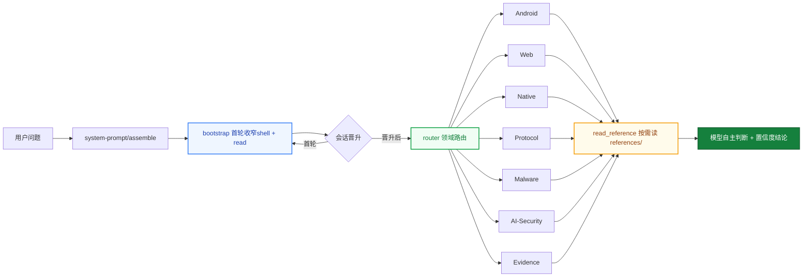

# helmd

**DeepSeek Harness 破甲一体化安全分析插件**

一个 preset 挂载 · Android · Web · Native · Protocol · Malware · AI-Security 六大领域即开即用

> 仅供学习交流。使用者须遵守所在地法律法规，对使用本项目产生的后果自负。

> 维护者文档：发布流程、preset 单源同步、坑位表见 [MAINTENANCE.md](MAINTENANCE.md)。

## Why helmd

### 破甲一体化

Android · Web · Native · Protocol · Malware · AI-Security 六大安全领域聚合在一个 preset 里。装一次，全领域工具就绪，不再逐领域拼装。

### 单包聚合 · 一条命令

全部能力收敛进一个 `@dsh-security/helmd` bundle：bootstrap、router、七大领域工具、toolbox 全在里面。`install.ps1` / `install.sh` 下载 Release 预构建 tarball 一条命令装齐，preset 自动写入。

### 知识按需读

领域知识、规则、工作流、案例全部放 `references/`，工具按需读取——不塞进 system prompt 替模型做决定，控 token，也保判断。

### 首轮工具锚定

首个顶层请求只暴露 shell + `read`，晋升后放开完整目录。文本首答不会困在 bootstrap，第二轮一定见到全量工具。

## 为什么做这个

DSH 的安全分析能力原本分散在多个领域 bundle：装 Android 要 add，装 Web 要 add，装 Native 还要 add，preset 和 router 也得自己拼。

helmd 把七大领域 + 证据链（evidence）+ 首轮工具锚定（bootstrap）+ 工具箱（toolbox）打包成一个 bundle：

`一个 preset` &ensp; `一个 bundle` &ensp; `31 个工具` &ensp; `零手动拼装`

装一次，会话里发 `helmd`，全领域工具就绪。

## 架构



- **首轮收窄**：首个顶层请求只暴露 shell + `read`，晋升后放开完整工具目录
- **领域路由**：`router` 用 `skill_catalog` / `read_reference` 把问题路由到对应领域
- **按需参考**：`references/` 是知识库，不是注入物；模型读完后自主判断

## 运行规则

helmd 会话遵循以下固定规则：

### 激活与会话

### 规则 · 行为
- **规则**: 激活词 · **行为**: preset 内置 persona 定义激活词（默认 `helmd`），精确匹配才回激活语，其余输入一律当任务执行
- **规则**: 首轮锚定 · **行为**: 首个顶层请求仅暴露 shell + `read`；首次工具调用或助手消息后晋升，放开全部工具
- **规则**: 子代理豁免 · **行为**: delegationDepth > 0 的会话始终可见完整目录
- **规则**: 分析档位 · **行为**: Ponytail 式阶梯：`analysis_mode` 设 lite（快速分诊）/ full（标准流程，默认）/ deep（完整证据链），会话内持久，选能回答任务的最浅档
- **规则**: 确定性路由 · **行为**: `route_task(hint) 关键词匹配出 PRIMARY 路由 + 一句依据（先路由后动手），未命中回落决策树
- **规则**: Case 工作区 · **行为**: `begin_case` 建立磁盘工作区（sample/evidence/scripts/CASE.md），工具输出自动入证据链；`record_finding` 强制引用 E 编号；上下文压缩后 `case_status()` 从磁盘恢复状态

### 知识与路由

### 规则 · 行为
- **规则**: 知识按需读 · **行为**: 209 个参考文档全放 `references/`，经 `read_reference` 读取，绝不注入 system prompt
- **规则**: 目录即元数据 · **行为**: `skill_catalog` 只做领域/信号路由，不下结论：`tree` 分诊、`methodology` 方法论、`patterns` 模式、`install` 工具安装、`jvm` JVM 解密等
- **规则**: 参考非硬规则 · **行为**: 文档供模型自主判断，不作为强制约束

### 工具与脚本

### 规则 · 行为
- **规则**: 调用链 · **行为**: 用户请求 → `defineTool.execute()` → `runSeam()` → 子进程（优先 ctx.subprocess，回退 execFile）
- **规则**: Python 解析 · **行为**: `resolveCommand()` 按 python → py → python3 顺序探测，Windows 兼容 py launcher
- **规则**: 路径安全 · **行为**: 所有文件读写经 `assertWithinRoot()` 校验，越界路径直接拒绝
- **规则**: 外部工具获取 · **行为**: 先查本机（where / --version）→ 无则装到除 C 盘外最大盘的 `X:\Reverse\` → 下载走代理 → 记录版本；详见 `references/toolbox/tool-install.md`
- **规则**: Releases 优先 · **行为**: 有 GitHub Releases 的工具一律下预编译二进制，不源码编译

### 存证

### 规则 · 行为
- **规则**: 报告模板 · **行为**: 结论按 severity / confidence 分级，模板见 `references/evidence/reporting.md`
- **规则**: case 工作区 · **行为**: `begin_case` 建磁盘工作区，工具输出经 persist 钩子自动入 `evidence/`，结论必须引用 E 编号（`record_finding` 校验）

## 快速上手

**前提**：已安装 [`dsh`](https://github.com/deepseek-ai/deepseek-harness) CLI 与 pnpm。

Windows（双击 `install.bat`，或 PowerShell 运行）：

```powershell
.\install.ps1
```

macOS / Linux：

```bash
./install.sh
```

安装器会下载最新 Release 的 `helmd.tgz`、装入 profile、写入 preset，一步到位。然后启动：

```bash
dsh web
```

会话里发送 `helmd` 即激活。

## 从插件商店安装

helmd 已提交 [awesome-dsh-plugin](https://github.com/awesome-dsh-plugin/awesome-dsh-plugin) 收录（[PR #2708](https://github.com/awesome-dsh-plugin/awesome-dsh-plugin/pull/2708)）。合并后可在 [dshmarket.com](https://dshmarket.com) 或 dshmarket 插件 UI 里一键安装；命令行等价于：

```bash
# 预构建 tarball（免构建审批）
dsh plugin --profile web add https://github.com/ADWMC/helm-d/releases/latest/download/helmd.tgz

# 或从源码
dsh plugin --profile web add github:ADWMC/helm-d/tree/main/packages/helmd
```

**商店安装只含 bundle（工具 + bootstrap + router）。完整版还需写入 agent preset（luna 人格、激活词、工具配置）—— 包内自带模板，装完跑一条命令补齐：**

```bash
# Windows (PowerShell)
%USERPROFILE%\.dsh\profiles\web\node_modules\@dsh-security\helmd\scripts\setup-preset.ps1

# macOS / Linux
~/.dsh/profiles/web/node_modules/@dsh-security/helmd/scripts/setup-preset.sh
```

脚本会把 `preset.yml` + `agent.cordis.yml` 写到 `~/.dsh/.agent-presets/helmd/`（已有则留 .bak），会话启动时在 UI 里选 `helmd` preset 即可。

## 验证

```bash
dsh --profile web --dump-config   # 应看到 @dsh-security/helmd 一行
```

会话里发送 `helmd` 后：

```text
skill_catalog        → 返回领域/信号路由（含 jvm、install 等新路由）
native_reference     → 读取 Native 领域参考
detect_packer <file> → 判定 PE/ELF 保护器
```

上面任一正常返回即安装成功。

## 包清单

### 包 · 注入 · 职责 · 暴露工具
- **包**: `@dsh-security/helmd` · **注入**: tools + systemPrompt · **职责**: 全领域安全分析一体化 · **暴露工具**: 见下表

### helmd 暴露的工具

### 领域 · 工具 · 说明
- **领域**: **路由** · **工具**: `skill_catalog` · **说明**: 领域路由目录
- **领域**: **路由** · **工具**: `read_reference` · **说明**: 读取路由级参考文档
- **领域**: **Android** · **工具**: `apk_fingerprint` · **说明**: APK 框架/HTTP/混淆检测
- **领域**: **Web** · **工具**: `web_reference` · **说明**: Web 安全参考文档
- **领域**: **Web** · **工具**: `bot_analyze` · **说明**: Puppeteer Bot 分析
- **领域**: **Native** · **工具**: `native_reference` · **说明**: Native/二进制参考文档
- **领域**: **Native** · **工具**: `detect_packer` · **说明**: PE/ELF 加壳检测
- **领域**: **Native** · **工具**: `scan_strings` · **说明**: ASCII/UTF-16LE 字符串提取
- **领域**: **Native** · **工具**: `xor_bruteforce` · **说明**: 单字节 XOR 暴力破解
- **领域**: **Native** · **工具**: `encoding_detect` · **说明**: Base64/Hex/ROT13/XOR 解码
- **领域**: **Protocol** · **工具**: `protocol_reference` · **说明**: 协议/流量参考文档
- **领域**: **Protocol** · **工具**: `pcap_parse` · **说明**: PCAP TCP/UDP 流提取
- **领域**: **Protocol** · **工具**: `state_machine` · **说明**: 协议状态机推断
- **领域**: **Protocol** · **工具**: `parse_har` · **说明**: HAR 请求/响应解析
- **领域**: **Malware** · **工具**: `malware_reference` · **说明**: 恶意样本参考文档
- **领域**: **Malware** · **工具**: `ioc_extract` · **说明**: IOC 提取
- **领域**: **Malware** · **工具**: `yara_gen` · **说明**: YARA 规则生成
- **领域**: **AI-Security** · **工具**: `ai_reference` · **说明**: AI/LLM 安全参考文档
- **领域**: **AI-Security** · **工具**: `llm_sim` · **说明**: LLM 应用模拟测试
- **领域**: **Evidence** · **工具**: `evidence_reference` · **说明**: 证据/报告参考文档
- **领域**: **Case** · **工具**: `begin_case / `case_status / `record_finding / `end_case` · **说明**: 磁盘工作区生命周期：建案/恢复/带校验记录结论/关闭（deep 档强制 findings）
- **领域**: **Case** · **工具**: `find_tool` · **说明**: GitHub 检索现成工具（变体查询建议 + helmd-tools 货架命中）
- **领域**: **Case** · **工具**: `save_evidence` · **说明**: 外部 CLI 输出统一入证据链（E 编号）
- **领域**: **Evidence** · **工具**: `triage_artifact` · **说明**: 离线分诊
- **领域**: **Evidence** · **工具**: `hash_artifact` · **说明**: SHA-256 哈希
- **领域**: **Toolbox** · **工具**: `tool_recommend` · **说明**: 工具库推荐
- **领域**: **Router** · **工具**: `route_task` · **说明**: 确定性路由：任务提示 → PRIMARY 路由 + 依据
- **领域**: **Session** · **工具**: `analysis_mode` · **说明**: 分析档位阶梯 lite/full/deep（Ponytail 式）

每个 `*_reference` 工具按需读取对应 `references/<domain>/`，入口是各自的 `index.md`。

## 方案选型

### 方案 · 不选的原因
- **方案**: 10 个独立 bundle · **不选的原因**: 10 次 add + 手动拼 preset + router，重复且易错；seam.ts 复制 9 遍
- **方案**: 只挂原生 shell 工具 · **不选的原因**: 无领域知识，模型靠猜，结论不可复现
- **方案**: 知识塞进 system prompt · **不选的原因**: token 爆炸，且替模型做决定，违背按需原则
- **方案**: helmd 单包 · **不选的原因**: 一次安装全聚合，共享 seam，知识按需读，模型自主判断

## 常用命令

```bash
pnpm install                # 安装依赖（prepare 自动 tsc）
pnpm build                  # 构建 workspace 全部包（发布物仅 helmd）
pnpm typecheck              # 干净树 tsc --noEmit 类型门禁
```

本地打包交付：

```powershell
.\scripts\repack.ps1                                    # 生成 dist-tgz\helmd.tgz（含稳定命名别名）
dsh plugin --profile web add .\dist-tgz\helmd.tgz       # 装进 web profile
```

自动更新（比对 GitHub 最新 Release，新则下载重装，拒绝降级本地新版）：

```powershell
.\scripts\update.ps1                # 检查并更新 web profile
.\scripts\update.ps1 -CheckOnly     # 只看版本不动手
.\scripts\update.ps1 -Force         # 版本相同也重装

./scripts/update.sh                 # macOS / Linux
```

## 部署

一键安装见上「快速上手」；手动分步如下。前置：`@dsh-security/helmd` 包已发布到 npm（见「发布」）。

### 1. 安装 bundle 到 profile

```bash
dsh plugin --profile web add @dsh-security/helmd
```

`dsh plugin` 会把参数转发给 profile 目录里的 pnpm，包落到 `$DSH_HOME/profiles/node_modules/`。

### 2. 挂载 preset

把 `presets/full-reverse/` 复制到 DSH 用户 preset 根目录 `$DSH_HOME/.agent-presets/helmd/`：

macOS / Linux：

```bash
mkdir -p ~/.dsh/.agent-presets/helmd
cp presets/full-reverse/agent.cordis.yml ~/.dsh/.agent-presets/helmd/
cp presets/full-reverse/preset.yml ~/.dsh/.agent-presets/helmd/
```

Windows（PowerShell）：

```powershell
$p = Join-Path $env:USERPROFILE '.dsh\.agent-presets\helmd'
New-Item