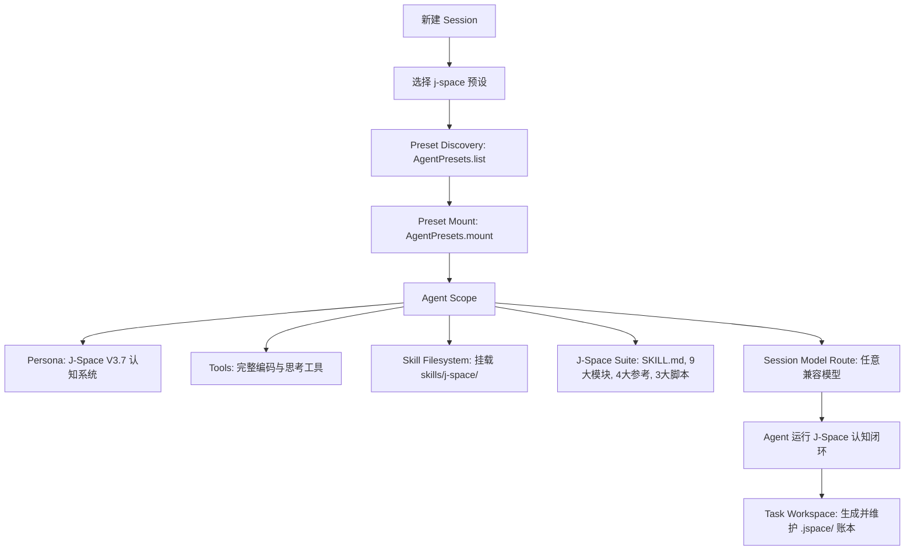

# 🚀 dsh-plugin-j-space

> **J-Space Cognition Suite V3.7** 原生 DeepSeek Harness (DSH) Agent Preset 预设与独立 Cordis 插件包。
> 注入内部表征认知路由、工作区状态外化账本（`.jspace/`）与自适应检验，全面释放大语言模型推理潜能。

## 🌟 项目简介

`dsh-plugin-j-space` 将 [J-Space Cognition Suite V3.7](https://github.com/Tiger3807861189/J-Space-Cognition-Suite-V3.7) 完整集成为 DeepSeek Harness 的一等公民 **Agent 预设 (Preset)**。

它不是粗暴的 Prompt 拼接，而是真正参与 Cordis **Agent Scope 生命周期隔离、多层认知路由、工作区状态外化账本（`.jspace/`）与自适应验证** 的完整体系，完全解耦并兼容任意大语言模型（DeepSeek-Chat、DeepSeek-Reasoner、Claude、GPT 等）。

### ✨ 核心特性
1. **即插即用（Zero-Config Preset）**：部署预设后，DeepSeek Harness 会话创建菜单自动出现 `J-Space Cognition Suite` 预设。
2. **全生命周期 Scope 隔离**：遵循 Cordis 作用域规范，工具和认知技能严格限定在 J-Space Agent 会话中，不污染其他预设。
3. **工作区状态外化账本（Active Ledger）**：通过 `jspace.py` 在任务工作区（`cwd`）自动建立 `.jspace/` 认知账本，实现目标跟踪、接缝审计（Seam）、自检断言与断点恢复。
4. **模型解耦与动态路由**：无缝适配各类基底模型，动态解析模型路由与工作区上下文。

## 📸 运行与效果预览

### DSH 预设选择（即插即用） · J-Space 认知工作流实况
- **DSH 预设选择（即插即用）**:  · **J-Space 认知工作流实况**: 

## 📊 实验与评测数据报告（实测对比）

> 完整测试报告引自原作者实测：[DeepSeek-V4-J-Space-Capability-Realization-Report](https://github.com/Tiger3807861189/DeepSeek-V4-J-Space-Capability-Realization-Report)

### 🔬 评测方法与实验设置
- **评测基底**：`DeepSeek-V4-Flash-Vision-Exp`
- **运行环境**：DeepSeek Harness (标准模式)
- **评测方式**：对权威基准子集与同类型小集（Terminal-Bench 2.1 中 medium 20 / hard 10，DeepSWE 中 TypeScript 10 / Python 10 / Go 10 / JavaScript 2 / Rust 2，GAIA 中 level1 / level3 等）进行严格的 **有/无 J-Space 臂对照（A/B Testing）**，同模型、同环境、同采样参数，仅切换 J-Space 接入。
- **测算维度**：① 准确率（Accuracy）；② 墙钟与 token 效率（Wall-Clock & Token Efficiency）。

### 1. 主基准测试准确率对比（Main Benchmark Table）

### Benchmark 基准测试 · DeepSeek V4-Flash (基线) · DeepSeek V4-Flash **+ J-Space V3.7** · GLM-5.3 · Kimi-K3 · Opus-4.8 · Fable 5 (w/ fallback)
- **Benchmark 基准测试**: **HLE (w/o tools)** · **DeepSeek V4-Flash (基线)**: *37.8 · **DeepSeek V4-Flash **+ J-Space V3.7****: **37.8** · **GLM-5.3**: — · **Kimi-K3**: 43.5 · **Opus-4.8**: 49.8 · **Fable 5 (w/ fallback)**: 53.3
- **Benchmark 基准测试**: **HLE (w/ tools)** · **DeepSeek V4-Flash (基线)**: *51.5 · **DeepSeek V4-Flash **+ J-Space V3.7****: **51.9** · **GLM-5.3**: 62.5 · **Kimi-K3**: 56.0 · **Opus-4.8**: 57.9 · **Fable 5 (w/ fallback)**: 63.0
- **Benchmark 基准测试**: **Terminal Bench 2.1** · **DeepSeek V4-Flash (基线)**: 83.9 · **DeepSeek V4-Flash **+ J-Space V3.7****: **85.5** · **GLM-5.3**: 88.2 · **Kimi-K3**: 88.3 · **Opus-4.8**: 85.0 · **Fable 5 (w/ fallback)**: 88.0
- **Benchmark 基准测试**: **NL2Repo** · **DeepSeek V4-Flash (基线)**: 57.7 · **DeepSeek V4-Flash **+ J-Space V3.7****: **60.4** · **GLM-5.3**: 58.0 · **Kimi-K3**: 58.0 · **Opus-4.8**: 69.7 · **Fable 5 (w/ fallback)**: —
- **Benchmark 基准测试**: **CyberGym** · **DeepSeek V4-Flash (基线)**: 75.3 · **DeepSeek V4-Flash **+ J-Space V3.7****: **77.8** · **GLM-5.3**: 84.5 · **Kimi-K3**: 80.0 · **Opus-4.8**: 78.3 · **Fable 5 (w/ fallback)**: 83.1
- **Benchmark 基准测试**: **DeepSWE** · **DeepSeek V4-Flash (基线)**: 59.3 · **DeepSeek V4-Flash **+ J-Space V3.7****: **61.8** · **GLM-5.3**: 66.9 · **Kimi-K3**: 67.5 · **Opus-4.8**: 58.0 · **Fable 5 (w/ fallback)**: 70.0
- **Benchmark 基准测试**: **Toolathlon-Verified** · **DeepSeek V4-Flash (基线)**: 75.9 · **DeepSeek V4-Flash **+ J-Space V3.7****: **77.4** · **GLM-5.3**: 73.0 · **Kimi-K3**: 76.5 · **Opus-4.8**: 76.2 · **Fable 5 (w/ fallback)**: 77.9
- **Benchmark 基准测试**: **Agents' Last Exam** · **DeepSeek V4-Flash (基线)**: 27.3 · **DeepSeek V4-Flash **+ J-Space V3.7****: **28.3** · **GLM-5.3**: 28.5 · **Kimi-K3**: 27.6 · **Opus-4.8**: 25.7 · **Fable 5 (w/ fallback)**: 23.8
- **Benchmark 基准测试**: **AutomationBench (Public)** · **DeepSeek V4-Flash (基线)**: 25.7 · **DeepSeek V4-Flash **+ J-Space V3.7****: **27.6** · **GLM-5.3**: 48.2 · **Kimi-K3**: 30.8 · **Opus-4.8**: 27.2 · **Fable 5 (w/ fallback)**: 29.1
- **Benchmark 基准测试**: **⭐ 综合均分 (Average)** · **DeepSeek V4-Flash (基线)**: 56.99 · **DeepSeek V4-Flash **+ J-Space V3.7****: **58.61** · **GLM-5.3**: 64.54 · **Kimi-K3**: 60.96 · **Opus-4.8**: 58.33 · **Fable 5 (w/ fallback)**: 62.13

*\* 注：HLE 数据未披露，沿用 DeepSeek V4-Flash-0731。综合均分覆盖六列均有值的 7 个项目行。*

### 2. 速度与 Token 消耗效率对比（Speed & Token Efficiency）

### Benchmark 基准测试 · 墙钟时间比 τ · 提速幅度 · 输出 Token 变化 · 总 Token 变化 · **单位时间得分 (产出比)** · 每成功任务成本
- **Benchmark 基准测试**: **HLE (w/o tools)** · **墙钟时间比 τ**: *1.02 · **提速幅度**: −2% · **输出 Token 变化**: −10% · **总 Token 变化**: +5% · ****单位时间得分 (产出比)****: **0.98×** · **每成功任务成本**: +5%
- **Benchmark 基准测试**: **HLE (w/ tools)** · **墙钟时间比 τ**: 0.88 · **提速幅度**: **+14%** · **输出 Token 变化**: −22% · **总 Token 变化**: +3% · ****单位时间得分 (产出比)****: **1.15×** · **每成功任务成本**: +2%
- **Benchmark 基准测试**: **Terminal Bench 2.1** · **墙钟时间比 τ**: 0.79 · **提速幅度**: **+27%** · **输出 Token 变化**: −28% · **总 Token 变化**: −3% · ****单位时间得分 (产出比)****: **1.29×** · **每成功任务成本**: **−5%**
- **Benchmark 基准测试**: **DeepSWE** · **墙钟时间比 τ**: 0.78 · **提速幅度**: **+28%** · **输出 Token 变化**: −28% · **总 Token 变化**: −3% · ****单位时间得分 (产出比)****: **1.34×** · **每成功任务成本**: **−7%**
- **Benchmark 基准测试**: **Toolathlon-Verified** · **墙钟时间比 τ**: 0.86 · **提速幅度**: **+16%** · **输出 Token 变化**: −25% · **总 Token 变化**: +2% · ****单位时间得分 (产出比)****: **1.19×** · **每成功任务成本**: +0%
- **Benchmark 基准测试**: **AutomationBench (Public)** · **墙钟时间比 τ**: 0.76 · **提速幅度**: **+32%** · **输出 Token 变化**: −31% · **总 Token 变化**: −5% · ****单位时间得分 (产出比)****: **1.41×** · **每成功任务成本**: **−12%**

*\* 注：HLE (w/o tools) 的 τ=1.02 是**有意为正**（即单轮无工具任务下略微变慢），因为在单轮短任务中注入完整的技能条目是净开销；而在长链路、多轮工具交互任务中（如 Terminal Bench、DeepSWE、AutomationBench），J-Space 认知套件带来 **+14% ~ +32% 的大幅提速**、**降低 28%~31% 的输出 Token 冗余**，单位时间产出比提升高达 **1.15× ~ 1.41×**。*

## 🚀 安装与一键部署

本插件内置了开箱即用的原生 Node.js CLI 工具，无需额外安装其他依赖即可直接执行安装：

### 方式一：通过 npm / pnpm 安装（官方源）

```bash
# npm 安装
npm install -D @anonyjcy/dsh-plugin-j-space

# pnpm 安装
pnpm add -D @anonyjcy/dsh-plugin-j-space

# 运行 CLI 一键部署预设
npx @anonyjcy/dsh-plugin-j-space install
```

### 方式二：克隆仓库直接安装（本地使用）

```bash
git clone https://github.com/AnonyJcy/dsh-plugin-j-space.git
cd dsh-plugin-j-space

# 一键部署预设到 ~/.dsh/.agent-presets/j-space
node bin/cli.js install

# 检查安装状态与完整性
node bin/cli.js status
```

## 💡 使用方法

### 1. Web UI 界面
1. 打开 DeepSeek Harness Web 界面，点击 **New Session**（新建会话）。
2. 在 **Agent Preset** 下拉选单中，直接选择 **J-Space Cognition Suite**。
3. 选择任意兼容的模型（`deepseek-chat` / `deepseek-reasoner` 等）开始任务。

### 2. CLI 命令行
```bash
dsh --preset j-space "全面重构此模块并补充单元测试"
```

### 3. Cordis 配置文件组装 (`cordis.yml`)
```yaml
- id: j-space-plugin
  name: '@anonyjcy/dsh-plugin-j-space'
  config:
    autoDeploy: true
```

## 🧩 核心架构与数据流



## 🛠️ CLI 命令一览

```bash
node bin/cli.js install    # 安装 J-Space Preset 到 DSH 用户预设目录 (~/.dsh/.agent-presets/j-space)
node bin/cli.js uninstall  # 干净卸载 J-Space Preset
node bin/cli.js verify     # 校验已安装预设的套件完整性
node bin/cli.js status     # 查看当前安装状态与配置路径
```

## 📄 开源许可证

本项目基于 [MIT License](./LICENSE) 开源。套件第三方声明见 [THIRD_PARTY_NOTICES.md](./preset/skills/j-space/THIRD_PARTY_NOTICES.md)。