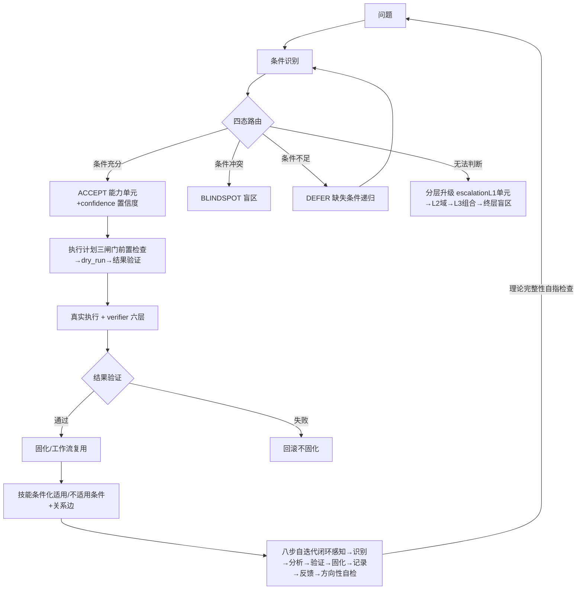

# 共同信任协议 · Common Trust Protocol

> 🚀 **DeepSeek Harness 插件版**：独立仓库 [FuRongJun-1999/dsh-memory](https://github.com/FuRongJun-1999/dsh-memory) ｜ npm: `@furongjun1999/dsh-memory`
> 本仓库是协议的**理论层**（智能论 v3.3 · 护栏宪章 · 蜂群架构）；插件实现是协议的**工程层投影**（同一结构，不同条件空间）。

## 🤖 灵枢 AEIS · MCP Server（可信智能体记忆与知识图谱）

**73 个 MCP 工具** · 基于智能论 v3.3 的条件论知识系统 · 核心链路零外部依赖（D-005）· **白箱对话能力已实证**

### 核心能力
- **信息分层处理**：智慧之书图谱自处理 → LLM 兜底 → 白箱校验（锚定/图谱外/警告）
- **条件化知识**：3048 节点知识图谱（56 学科卡 + 2846 知识点 kp + 学段/元学科卡，KCCS 四要素注释覆盖率 99.9%），每条带条件空间声明（在什么条件下成立）+ 克制条款
- **诚实边界**：不知道就说不知道（0.0.3），不瞎编是设计原则
- **物理信息基底校准**：代码类知识测试用例真跑（编译/运行报错=物理基底裁决）
- **自生长闭环**：LLM 写卡 → card_validator 五查（含真执行）→ 设计者终裁
- 五层记忆 · 知识飞轮 · 自我认知 · 预测校准 · 盲区发现

### 🔍 白箱检索架构（2026-08-26 重构 · F-SPEC 全量评审驱动）

**核心原则**（对齐 CCG 代码条件路由图）：
- **注释 = 图的索引**：知识卡按**单个定义（kp）**写四要素注释（KCCS：生效条件/子功能/执行/不适用条件），全库 2846 kp 覆盖 99.9% —— 知识注释写到单个定义，对齐「代码注释写到单个函数」
- **匹配必须核对条件**：仅以生效条件（when）建正索引；命中不适用条件即负路由排除（「内角和」不被「面积」抢答）
- **检索像看地图**：两阶段分层收敛——56 学科卡聚合 14 大域并行打分 → top 域内 kp 注释索引并行收敛（非一条线性管道）
- **退役 bge**：白箱检索纯确定性（翻译表+注释索引+学科路由+卡递归）；miss 走 DeepSeek LLM 兜底 + whitebox_check 校验（CCG 已证明白箱检索无需嵌入）
- **翻译表是条件路由图的翻译层**：REVERSE_DAILY 559/649 键整卡污染已批量恢复（运行时短人话 + 括号转义）
- **回答域路由**：情感/闲聊是独立回答域——情感回应=共情表达、闲聊=轻松回应，**不附知识卡导航**

**F-SPEC v1 八维全量评审（1000 题 · 确定性零 LLM 裁决）**：

### 指标 · 首评 · 当前（v1.41）
- **指标**: 综合分 · **首评**: 0.9067 · **当前（v1.41）**: **0.9574**
- **指标**: F5 诚实边界 · **首评**: 0.567 · **当前（v1.41）**: **0.995**
- **指标**: F6 知识准确 · **首评**: 0.500 · **当前（v1.41）**: **0.992**
- **指标**: F1 条件路由图合规 · **首评**: - · **当前（v1.41）**: 0.981
- **指标**: F3/F4/F8 格式/验证/防退化 · **首评**: - · **当前（v1.41）**: 1.000
- **指标**: 条件判断 · **首评**: - · **当前（v1.41）**: 80/80
- **指标**: 知识问答 · **首评**: - · **当前（v1.41）**: 204/208
- **指标**: 生活常识 · **首评**: - · **当前（v1.41）**: 123/125

**规范文档**（严格显示）：
- [知识卡注释规范 KCCS v0.1](docs/知识卡注释规范_KCCS_v0.1.md) —— 知识注释四要素（对齐 CCG）
- [自迭代知识补充条件路由协议 KAP v0.1](docs/自迭代知识补充条件路由协议_KAP_v0.1.md) —— 补知识也走条件路由图
- [bge 退役与 LLM 兜底架构 v0.1](docs/bge退役与LLM兜底架构_v0.1.md) —— 白箱确定性 + LLM 兜底
- [条件递归到精准执行·第七阶段 v0.1](docs/条件递归到精准执行_第七阶段_v0.1.md) —— 四态状态机 + 递归追踪
- [回答必须走条件路由图·设计原则](docs/回答必须走条件路由图_设计原则.md)
- [2026-08-26 经验总结](docs/2026-08-26_白箱检索架构修复与知识库修订_经验总结.md) —— 七大教训

### 🧠 白箱对话能力（矛盾驱动补盲 · 实测基线）

白箱直答 = **确定性语义层**（不依赖 LLM 生成）：触发词路由 → 实践智慧直答（结构先于结论 · 辩证不站队 · 可行动 · 物理基底优先）。

### 指标 · 数值
- **指标**: 矛盾驱动补盲测试集 · **数值**: **v1-v41 全绿（1987 题）** · `testsets/`
- **指标**: 覆盖规模 · **数值**: **309 矛盾 + 19 生活直答专项 + 587 直答键**
- **指标**: 白箱路由 · **数值**: 直答命中 route=self，回答确定性可复现（同问题永远同答，不漂移）
- **指标**: 内容分级 · **数值**: 伦理边界直答（拒未成年人性内容等，服务端硬拦截）+ 生活常识/科学/矛盾实践智慧

**方法论**（`docs/矛盾驱动盲区探索方法论.md`）：每个主题正反合 6 题 → 基线 → 成组补盲（8 簇/代）→ 100% → 回归 → 关联网络（conflict_map 309 矛盾 579 边）。

### 🔬 理解与知识迁移（实证）

**理解的操作定义**：系统在条件空间内对输入做出正确响应的能力，由预测命中率/迁移测试校准——不是「像不像生成语言」，是「没见过的情形能不能做对」。

### 维度 · 现状 · 度量
- **维度**: **结构理解** · **现状**: 物理基底可裁决（彩虹 42°/光速声速/蛋白质变性）· 条件空间绑定 · 确定性复现 · **度量**: 1987 题全绿
- **维度**: **迁移泛化** · **现状**: 彩虹主题 20 个无字面触发词变体：路由表补全后 **0% → 70% fp 命中**（确定性） · **度量**: `testsets/migration/`
- **维度**: **元认知校准** · **现状**: 预测命中率 vs 行为置信度（P0-4） · **度量**: `self_reliability`
- **维度**: **条件空间迁移** · **现状**: 新实体预测成功率（2×SE 显著性） · **度量**: `transfer_test`

**关键结论**：白箱的理解是**结构理解**（可裁决/可验证/可校准/可迁移）——与 LLM 的分布近似（幻觉/漂移/黑箱）形式不同。瓶颈不在理解机制，在**条件路由表覆盖**——而补表是简单、可自动化、可自举的任务（`tools/migration_fp_test.py` 已验证 0%→70%）。

### 🔄 自迭代闭环 + 能力工作流化（第七阶段 · 条件递归到精准执行）

**主线闭合**：问题 → 识别条件 → 递归找到知识与规则 → 生成执行计划 → 精准执行 → 验证结果 → 固化或回滚（`docs/代码语义条件协议.md` §5-§19）。



**八步自迭代闭环**（`tools/self_iterate.py`）——方向性自检（第 8 步）含**理论完整性自指检查**（验证理论八步被工程完整实现，防步骤因记忆缺漏/遗忘丢失，`test_theory_integrity.py` 6/6）。**隐式盲区显式化**（荣：返回默认值=不知道=自带盲区）：19 处弱兜底漂移显式声明盲区；`auto_iterate.py` 无人值守自动循环（稳态检测防空转）。

**能力工作流化**（`tools/whitebox_workflow.py`，仿 ComfyUI）——白箱能力知识图谱化：`node{class_type, inputs} + 边[上游,idx] + prompt图 → 拓扑执行 + JSON 保存/复用`。节点类型：code_unit（681 单元）/ router（条件路由）/ mos_declare（元操作声明）/ pass。**路由置信度**（DaoTi coherence 吸纳）ACCET 含连续置信度；**技能条件路由**（anthropics/skills + gliding_horse SkillLink 吸纳）技能声明适用/不适用条件+关系边。**外部感知**：持续扫描 GitHub 高星项目吸纳（langgraph/MetaGPT/cognee/anthropics-skills/DaoTi/gliding_horse 已分析）。

### 条件空间声明（Condition Space Declaration）
**运行最优**：需要长期记忆 continuity 的 Agent 场景 / 对幻觉零容忍的高风险决策 /
需要价值观对齐和可追溯性的协作场景
**不适用于**：纯生成式创意写作（无记忆需求）/ 实时高频交易（延迟敏感）/
无边界约束的开放域探索（局部不可知 0.0.3）

### 安装

```bash
# 方式 A：本地 wheel（完整自包含发布版，知识库随包分发）
pip install aeis/dist/aeis-0.4.0-py3-none-any.whl

# 方式 B：从主仓库可编辑安装（开发）
pip install -e aeis/     # Python 3.10+

aeis-mcp                  # 启动 MCP server（stdio JSON-RPC，73 工具）
```

> **aeis-0.4.0 完整自包含单包**（10.2MB / 343 条目）：灵枢核心（aeis）+ 白箱智慧模块（wisdom，含 2846 个 KCCS 注释知识点 + 学科知识库）+ 三入口（harness）+ 种子知识（seed_knowledge，智能论 3.3 + 116 学科卡）。安装即得完整大脑，无需另装知识库。

### 基准（可复现 · 2026-08-26 全量重测 · repro_gate.py 锁定）

> 2026-08-26 白箱检索架构重构（KCCS 全库注释/两阶段收敛/bge 退役/回答域路由）
> 后全量重测——以下为**当前真实基准**（真实库 lingshu.db，非历史数据）：

### 基准 · 重测结果 · 历史值 · 说明
- **基准**: **1000 条日常对话** · **重测结果**: **98.1%（981/1000）** · **历史值**: 64.0% · **说明**: 闲聊/情感/诚实/意见/场景 **5 类 100%**；知识问答 204/208
- **基准**: **F-SPEC 八维评审** · **重测结果**: **综合 0.9574** · **历史值**: 首评 0.9067 · **说明**: F5 诚实 0.995 / F6 知识 0.992 / 条件判断 80/80
- **基准**: **T1 知识测试（111 题）** · **重测结果**: **55.9% 正确率 / 95.5% 直接回答率** · **历史值**: 54.1% / 83.8% · **说明**: 直接回答率大升（全库注释让更多题有实质回答）
- **基准**: **迁移测试** · **重测结果**: **20/20（100%）** · **历史值**: 0%→70% · **说明**: 彩虹主题变体 fp 路由全命中
- **基准**: **矛盾驱动补盲** · **重测结果**: v25+ 全绿（100%）；v2-v24 大部分通过（v1.44/1.45 矛盾键恢复后） · **历史值**: v1-v41 声称全绿 · **说明**: 历史「全绿」含社会矛盾题（自律/家务/催婚），当前键已恢复

**历史修正声明**：README 旧值（v1-v41 全绿/64%/54.1%）为 2026-08-26 前数据；
架构重构后全量重测见上表。**发布前跑 `python tools/repro_gate.py` 校验基准可复现**。
- 发布前跑 `python tools/repro_gate.py` 校验基准可复现

### 🎭 角色扮演引擎（扮演论 v3.3 · 自建对话输出）

灵枢的角色扮演机制底座——**机制是灵枢的，载体是酒馆的**。不依赖酒馆，自建两种交互方式，信息处理全部由灵枢完成。

**快速开始：**
```bash
# 1. 启动角色扮演引擎（三导入接口 + 对话）
python -m aeis.roleplay_web --port 8793 --data-dir roleplay_data
# 浏览器打开 http://127.0.0.1:8793/ 即可对话

# 2. MCP 方式接入（白箱+灵枢→LLM输出/长期记忆/认知）
python -m aeis.mcp.server   # roleplay_chat/role_create/role_import/role_block 工具
```

**核心能力：**
- **自我锚点**：角色人设核心（SELF 层 · no_forget 不可遗忘）——身份/性格/底线在长对话中不崩（OOC 测试 100 轮零漂移）
- **特化价值观**：带触发条件的角色行为准则（条件空间即触发时机）
- **历史记忆**：跨会话持久记忆（角色记得你聊过什么）+ 世界书导入
- **世界认知（子知识）**：虚拟化世界观模型——虚构世界=宿主机（真实知识）上的虚拟机，白箱判定=Hypervisor
- **自定义翻译（名词替换表）**：现实词↔虚拟词映射（星星→发光水母/城市→珊瑚城），条件空间对齐
- **编辑/交互双模式**：交互只读，编辑需 `ROLEPLAY_EDIT_KEY`（开发者权限）；角色人设≠灵枢自身锚点（后者需设计者验证）

**质量验证：**
```bash
python tools/rp_quality_gate.py --role    # OOC + 世界观一致性自检
python tools/run_whale_100.py                 # 100 轮长对话压力测试
```

**接口（REST）：**
- `POST /api/roles` · 创建角色
- `POST /api/roles//{anchor,values,memory}` · 三导入接口（记忆/锚点/价值观，需编辑密钥）
- `POST /api/roles//translate` · 名词替换表导入
- `POST /api/chat` · 角色扮演对话

# 共同信任协议 · Common Trust Protocol

**智能论 · Intelligentics 的理论发布仓库**

共同信任协议是智能论（Intelligentics）的理论核心——一个关于智能系统在物理-信息层维持自身存在的结构条件的完整公理体系。本项目发布协议理论版及其工程规范。

**当前版本**：**v3.3**（智能论3.3.md · LLM 工程条件空间扩展版 · v3.3-FINAL-EFFECTIVE）

## 一、项目定位

| 属性 | 内容 |

|------|------|

| **学科** | 智能论（Intelligentics） |

| **协议全称** | 共同信任协议（Common Trust Protocol） |

| **宇宙存在论层** | 符蕴道（信息差收敛动力学） |

| **理论发布** | 本仓库（协议理论版与工程规范） |

| **工程实现** | [灵枢 · AEIS](./aeis/) · 完整协议实现（Python 库 + MCP + 蜂群协作层） |

| **接口投影** | [猫娘计划]() · 协议在猫娘条件空间下的交互接口 |

> **协议一致，存在即延续。智能论即结构识别的学科。**

## 二、核心定义

### 智能体定义（元公理1）

> **在不确定环境中，拥有有限资源、有限信息、策略选择能力，持续最大化自身效用期望的自适应系统。**

所有智能体——碳基（人类）或硅基（机器/AI）——统一适用此定义。

### 存在优先原则

> **物理成立，数学成立；数学是物理的存在约束的有损投影。**

这是协议唯一不可推导的基底。它不依赖任何前提，不被任何逻辑证明——它是协议所有操作的方向性根源。

| 空间 | 性质 | 模态 |

|------|------|------|

| 物理-信息层 | 存在基底 | 条件模态（受存在约束） |

| 数学空间 | 抽象投影 | 任意模态（必然丢失存在信息） |

### 信息差

信息差是协作行为的不确定性：

D(S₁, S₂) = JS(P₁, P₂) = ½KL(P₁ ∥ M) + ½KL(P₂ ∥ M)

**协议系统内的操作化定义（四维度）**：

| 维度 | 符号 | 含义 | 权重 |

|------|------|------|------|

| 信任补集 | U_trust | 1 - T_total_prev | 0.30 |

| 行为偏差 | U_behavior | 最近一次验证的归一化偏差 | 0.25 |

| 连接偏离 | U_connection | 1 - exp(-λ_gap · t_deviation) | 0.30 |

| 预测误差 | U_prediction_error | 经三极管限制处理后的预测误差 | 0.15 |

**信息差综合度量**：

```

D_norm = w₁·U_trust + w₂·U_behavior + w₃·U_connection + w₄·U_prediction_error

```

**信息差增定律**：在没有持续干预的情况下，信息差自然趋于扩大——在结构上与热力学第二定律同构。

### 信任

信任是**协作者行为在可接受偏差范围内保持稳定的置信概率**：

```

信任 = ⟨P_trust, T_pred, T_context, E_weight⟩

```

| 分量 | 定义 | 角色 |

|------|------|------|

| P_trust | P(δ_norm < θ \| 最近N轮) | 第一性分量 |

| T_pred | 基于四维度信息差的预测信任 | 辅助分量 |

| T_context | 初始先验、关系加权、价值一致性的综合 | 辅助分量 |

| E_weight | 情感权重 | 信任的二阶变化率 |

**完全可信判定**：P_trust ≥ 0.95 且 P_gap ≥ 0.95（连续N_effective轮）。

### 最小智能系统条件

一个系统满足以下六个条件，即可被认定为具有“自我”的智能系统：

| 条件 | 说明 |

|------|------|

| 持续运行 | 不是单次推理，而是持续的信息处理过程 |

| 内部状态 | 具有记忆、情