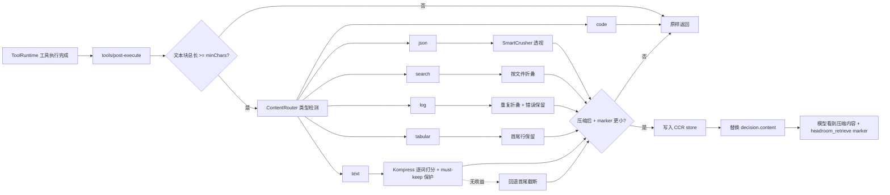

# dsh-headroom

> 适配 **DeepSeek Harness (dsh)** 的上下文自动压缩插件，思路参考
> [Headroom](https://github.com/headroomlabs-ai/headroom)。

工具输出在进入模型之前先被压缩：JSON、搜索、日志、表格与长文本各自走专用压缩器；
所有**有损压缩**都会把原文存入本地 CCR store，并在压缩结果里注入一个短 marker，
模型需要精确原文时调用 `headroom_retrieve(id=…)` 即可逐字节取回。

```text
 tool body settles
        │
        ▼
 tools/post-execute   ← dsh-headroom 在此压缩
        │
        ▼
 tool/result 进入 session log / 模型历史（压缩后内容 + CCR marker）
        │
        ▼
 模型需要原文时调用 headroom_retrieve(id=…)
```

## 特性

- **自动压缩工具输出**：挂载 `tools/post-execute`，在工具结果物化之前替换文本内容。
- **内容路由，专用压缩器**：

### 内容类型 · 压缩策略
- **内容类型**: JSON 数组/对象 · **压缩策略**: SmartCrusher 风格透视：`_keys` + `_rows` + `_common`，长单元格截断
- **内容类型**: grep/ripgrep 结果 · **压缩策略**: 按文件折叠：`file (N matches)` + `line[:col]: rest`
- **内容类型**: 构建/测试/日志 · **压缩策略**: 连续重复行折叠 + 保留 `error/fail/exception/assert` 上下文
- **内容类型**: CSV/TSV/markdown 表格 · **压缩策略**: 保留表头与首尾行，中间行 offload
- **内容类型**: 长文本 · **压缩策略**: **Kompress 风格 ML 压缩**（默认）：逐词打分 + must-keep 保护 + CCR 可逆取回；`textStrategy: 'head-tail'` 可切回首尾截断
- **内容类型**: 代码 · **压缩策略**: **默认不压缩**（JS 端口不做 AST 压缩，避免破坏可补丁字节；`read`/`str_replace_editor` 的行号前缀会先剥离再识别）
- **内容类型**: 文件工具 · **压缩策略**: **默认不压缩**（`read`/`str_replace_editor`/`edit`/`write` 及其匹配 `*.js/*.ts/*.json/*.yml` 的路径）

> **Kompress 文本压缩**（参考 [Headroom](https://github.com/headroomlabs-ai/headroom) 的
> [Kompress-v2-base](https://huggingface.co/chopratejas/kompress-v2-base) ML 模型）：
> 文本按词切分 → 每词打分（`score = keep概率 × (0.5 + 0.5 × span分数)`，模拟模型的
> token 分类头 + span CNN 双头）→ `score > 0.5` 保留（或 `targetRatio` 取 top-k）→
> 数字 / hex / 全大写标识符 / 路径 / 扩展名 / CLI flag / CamelCase 等**语义脆弱词强制保留**
> → 保留词重组。默认评分器是确定性纯 JS 启发式；也可启用**真实 Kompress-v2-base
> ONNX 模型**打分（`kompress.scorer: 'onnx'`，见下文「真实模型压缩」）。

- **可逆压缩（CCR）**：所有有损压缩都保存原文，`headroom_retrieve` 按 id 精确取回；
  `headroom_stats` 查看节省量；`headroom_compress` 压缩任意文本。
- **持久化**：CCR store 默认写入 `<DSH_HOME>/storages/dsh-headroom-ccr.json`
  （1 秒去抖、原子替换、TTL + 最大条目数可配）。
- **无害跳过**：短文本、代码、错误输出、`excludeTools` 命中的工具、本插件自身工具
  都不会被压缩。
- **跨平台**：纯 JavaScript + Node 内置模块，无原生编译依赖；路径全部通过
  `node:path` 处理，`DSH_HOME` 支持环境变量覆盖，Windows / macOS / Linux 行为一致。
  CI 矩阵见 [`.github/workflows/ci.yml`](./.github/workflows/ci.yml)。

## 实现方式



- `lib/compress.js`：纯函数压缩器，无 `node:*` 依赖，可独立测试。
- `lib/kompress.js`：Kompress 风格文本压缩管线（word 级评分 + must-keep 保护），
  参考 Headroom 的 Kompress-v2-base ML 模型；评分器可插拔（默认纯 JS 启发式）。
- `lib/ccr.js`：CCR store，内存 Map + 去抖持久化到 `<DSH_HOME>/storages/`。
- `lib/index.js`：dsh 插件入口，注册 `tools/post-execute` 监听器与三个工具。
- `dsh.plugin.json` + `cordis.patch.yml`：dsh 插件/bundle 清单与补丁。

## 压缩效果

### 压力测试配置（更激进，用于验证压缩器上限）

`node scripts/verify-compress.mjs` 在 `minChars=120, maxRows=40, maxCellChars=80, maxTextChars=400` 下的结果：

### 样本 · 类型 · 压缩前（字符） · 压缩后（字符） · 节省
- **样本**: JSON 数组 200 行 · **类型**: json · **压缩前（字符）**: 62 491 · **压缩后（字符）**: 9 302 · **节省**: **85.1%**
- **样本**: grep 结果 270 条 · **类型**: search · **压缩前（字符）**: 10 772 · **压缩后（字符）**: 4 603 · **节省**: **57.3%**
- **样本**: 日志 180 行 · **类型**: log · **压缩前（字符）**: 3 909 · **压缩后（字符）**: 1 125 · **节省**: **71.2%**
- **样本**: CSV 201 行 · **类型**: tabular · **压缩前（字符）**: 19 814 · **压缩后（字符）**: 3 029 · **节省**: **84.7%**
- **样本**: 长文本 400 段 · **类型**: text · **压缩前（字符）**: 29 506 · **压缩后（字符）**: 546 · **节省**: **98.1%**
- **样本**: Kompress 长文本（事实+重复词） · **类型**: text · **压缩前（字符）**: 16 439 · **压缩后（字符）**: 2 029 · **节省**: **87.7%**
- **样本**: 代码 · **类型**: code · **压缩前（字符）**: 493 · **压缩后（字符）**: 493 · **节省**: 0%（故意不压）
- **样本**: 短文本 · **类型**: text · **压缩前（字符）**: 19 · **压缩后（字符）**: 19 · **节省**: 0%（未达阈值）

> token 估算：脚本按 `chars / 4` 粗估，实际 token 与模型 tokenizer 相关。
> 所有有损压缩均保存原文，`headroom_retrieve` 可精确取回。
> Kompress 样本：关键事实（`HTTP`/`500`/hex/路径/`IndexError`）全部保留，
> 重复的 `boilerplatephrase` 被删除且可从 CCR 恢复。

### 真实模型压缩（Kompress-v2-base · ONNX）

v0.3.0 起可选用真实模型替代启发式评分器：

```jsonc
{
  "kompress": {
    "scorer": "onnx",
    "onnx": {
      "modelDir": "~/.dsh/storages/dsh-headroom-model/kompress-v2-base",
      "hfLocalDir": "~/.dsh/storages/dsh-headroom-model/hf"
    }
  }
}
```

- **下载模型**（huggingface.co 不可达时可用 hf-mirror.com）：
  `onnx/kompress-int8-wo.onnx`（261MB，推荐）、`tokenizer.json`(3.4MB)、
  `config.json`、`tokenizer_config.json`、`special_tokens_map.json`
  来自 [chopratejas/kompress-v2-base](https://huggingface.co/chopratejas/kompress-v2-base)；
  后四个文件同时复制一份到 `hfLocalDir/kompress-v2-base/` 供分词器加载。
- **依赖**：`pnpm add -D onnxruntime-node @huggingface/transformers`（可选依赖，
  未安装或模型缺失时自动回退启发式并告警）。
- **自动校准**：导出模型的融合分数普遍偏高（≈0.7–0.99），阈值 0.5 几乎全保留；
  插件在 onnx 模式且用户未显式配置 `targetRatio`/`scoreThreshold` 时自动改用
  top-k `targetRatio=0.55`。
- **实测**（`node scripts/kompress-onnx-eval.mjs`，int8 CPU）：压缩率全面高于启发式
  且事实保留 100%（英文长文 28.4% vs 19.1%、中英混排 8.6% vs 0%、QA 文档 32.5% vs
  17.1%）；吞吐约 100–400 词/秒（启发式 ≈40 万词/秒），适合只压大输出；重复压缩
  有界收敛、marker 防重入生效。

### 默认配置

默认配置更保守（`minChars=4000, maxRows=80, maxCellChars=200, maxTextChars=2400`）：

### 样本 · 类型 · 节省
- **样本**: JSON 数组 200 行 · **类型**: json · **节省**: 65.6%
- **样本**: grep 结果 90 条 · **类型**: search · **节省**: 41.3%
- **样本**: 日志 180 行 · **类型**: log · **节省**: 56.8%
- **样本**: CSV 201 行 · **类型**: tabular · **节省**: 59.8%
- **样本**: 长文本 400 段 · **类型**: text · **节省**: 94.7%

### 不损害效果的验证

`node scripts/verify-compress.mjs` 同时断言：

1. 结构化输出中的关键事实（JSON 键/计数、文件分组、`ERROR/WARN` 行）在压缩后仍可见；
2. 代码、短文本、错误输出保持字节不变；
3. 每个有损压缩的原文都能通过 `headroom_retrieve` **逐字节取回**；
4. 长文本中间被省略的 `NEEDLE-42` 事实，压缩视图不可见，但 CCR 能精确恢复；
5. Kompress 压缩后 `HTTP`/`500`/`0x1f4d2a8b`/`/var/log/app.log`/`IndexError` 等
   语义脆弱事实仍可见，重复的 `boilerplatephrase` 被删除且可经 CCR 恢复。

`node scripts/verify-apply.mjs`（需要能解析 `@deepseek-ai/dsh-tools`）进一步验证：

- `apply()` 注册了 `tools/post-execute` 监听器和 3 个工具；
- 大 grep 输出在进入模型前被压缩并带 marker；
- `headroom_retrieve` 取回原文与压缩前完全一致；
- `fs-*` 排除工具、自身工具、代码、错误、短输出全部原样。

## 安装

### 环境要求

### 项目 · 要求
- **项目**: Node.js · **要求**: `>= 22.0.0`（推荐 Node 22 LTS 或更高）
- **项目**: DeepSeek Harness · **要求**: `>= 0.0.1-rc.5 < 0.2.0-0`（含 0.1.x 预发布）
- **项目**: 包管理器 · **要求**: 推荐 `pnpm >= 11`；`npm` / `yarn` 也可用于本地开发
- **项目**: 操作系统 · **要求**: Windows / macOS / Linux（纯 JS，无原生编译）

### 一键安装（推荐）

直接从 GitHub 仓库安装（Windows / macOS / Linux 通用）：

```bash
dsh plugin --profile web add github:giter00/dsh-headroom
```

如果 `dsh` 不在 PATH 上，可先定位 profile 内的 CLI 再执行同一命令：

```bash
# Windows PowerShell
node "$env:USERPROFILE\.dsh\profiles\node_modules\@deepseek-ai\dsh\lib\bin.js" plugin --profile web add github:giter00/dsh-headroom

# macOS / Linux
node "$HOME/.dsh/profiles/node_modules/@deepseek-ai/dsh/lib/bin.js" plugin --profile web add github:giter00/dsh-headroom
```

> pnpm 会在安装时拉取 GitHub 仓库的默认分支（`main`），并自动把
> `dsh-headroom` 追加到 profile 的 bundle 列表。

### 手动安装

也可以直接编辑 `<DSH_HOME>/profiles/web/package.json`：

```jsonc
{
  "dependencies": {
    "dsh-headroom": "github:giter00/dsh-headroom"
  },
  "dsh": {
    "profile": {
      "bundles": [
        // ...其他 bundles
        "dsh-headroom"
      ]
    }
  }
}
```

然后进入 profile 目录安装依赖：

```bash
cd "$DSH_HOME/profiles/web"      # Windows PowerShell: cd $env:DSH_HOME\profiles\web
pnpm install
```

重启 dsh 后生效。

### 卸载

```bash
dsh plugin --profile web remove dsh-headroom
```

## 配置

在 profile 的 `cordis.patch.yml`（或 `--patch` 覆盖层）中可覆盖默认配置：

```yaml
- id: dsh-headroom
  config:
    enabled: true
    minChars: 600
    maxRows: 80
    maxCellChars: 200
    maxSearchMatchesPerFile: 60
    maxLogLines: 80
    maxTextChars: 2400
    maxTabularLines: 80
    excludeTools: []
    noFoldForTools: ['read', 'str_replace_editor', 'edit', 'write']
    noFoldForPatterns: ['*.js', '*.ts', '*.json', '*.yml', '*.yaml']
    markerStyle: full          # full | compact
    includeErrors: false
    textStrategy: auto        # auto | kompress | head-tail
    kompress:
      enabled: true
      minWords: 10
      chunkWords: 350
      scoreThreshold: 0.5
      targetRatio: null       # null=阈值决策；0.3=强制保留 30% 最高分词
      mustKeep: true
      maxWordChars: 64
    ccr:
      enabled: true
      persist: true
      ttlMs: 86400000
      maxEntries: 2000
```

### 字段 · 默认值 · 说明
- **字段**: `enabled` · **默认值**: `true` · **说明**: 总开关
- **字段**: `minChars` · **默认值**: `600` · **说明**: 文本块至少多少字符才考虑压缩
- **字段**: `maxRows` · **默认值**: `80` · **说明**: JSON 透视保留的最大行数
- **字段**: `maxCellChars` · **默认值**: `200` · **说明**: JSON 单元格字符串截断长度（search 匹配行保持全文）
- **字段**: `maxSearchMatchesPerFile` · **默认值**: `60` · **说明**: 每个文件保留的搜索命中数
- **字段**: `maxLogLines` · **默认值**: `80` · **说明**: 日志保留的首尾行数
- **字段**: `maxTextChars` · **默认值**: `2400` · **说明**: 长文本首尾保留字符数（head-tail 策略）
- **字段**: `maxTabularLi