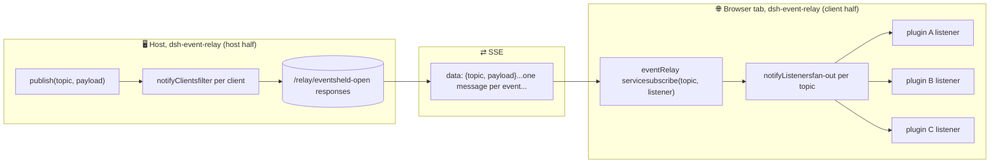

#dsh-event-relay

一个[DeepSeek Harness](https://github.com/deepseek-ai/deepseek-harness)(DSH)
插件：将其与您自己的插件一起安装到配置文件中。

**从主机推送到浏览器。** 主机可以开始对话；每隔一个
通道（fetch、RPC）需要浏览器先询问。如果你的插件的 UI
应该在主机端发生某些事情时做出反应（设置更改，
构建完成，通知到达），这就是那个频道。

一条共享 SSE 路由 (`/relay/events`) 保持每个订阅者的响应开放
并在事情发生时流式传输 JSON 消息 `{"topic","payload"}`。一
每个浏览器选项卡的连接，无论订阅了多少插件。

## 架构



## 插件价值主张

###替代方案·达不到要求
- **替代**：轮询·**达不到**：延迟+浪费（N次获取以了解“没有改变”）
- **替代**：重新获取焦点/导航 · **不足**：免费且正确，但仅在用户操作时更新
- **替代**：每个插件您自己的 EventSource/WebSocket · **不足**：浏览器上限约为 6 个连接/域 (HTTP/1.1)；一些插件永久占用它们和**所有其他请求队列**。此共享流是整个选项卡的一个连接
- **替代**：主机 RPC (`/api`) · **不足**：请求→响应：前端可以询问，但主机不能中断

**一个方向，有目的地。** 浏览器→主机是事务形状的（命令→
回复）：使用带有状态代码的纯 HTTP（主机一半注册的路由），
验证和错误处理是流所不具备的。主机→浏览器是
通知形状：不可预测的时刻，所有选项卡同时出现。不同的工作岗位，
不同的道路。

## 如何安装

需要 DeepSeek Harness 结账和个人资料（此处为 `web`）：

```sh
# from the harness checkout
pnpm dsh plugin --profile web add /path/to/dsh-event-relay

# verify the profile still composes
pnpm dsh --profile web --dump-config
```

然后（重新）启动线束；主机在启动时加载一半。浏览器插件
使用 `ctx.get('eventRelay')` 使用客户端服务，无需连接
除了安装这个包之外。

## 生产者（主机插件）

```js
const relay = ctx.get('eventRelay')            // optional, degrade if absent
relay.publish('my-topic', payload)             // direct
ctx.on('my/event', (data) => relay.publish('my/event', data))   // mirror a Cordis event (do this in your plugin)
```

## 消费者（浏览器捆绑包）

```js
const relay = ctx.get('eventRelay')            // provided by this package's client half
const unsubscribe = relay.subscribe('kanban', (topic, payload) => { ... })
// or raw: new EventSource('/relay/events?topics=kanban,notifications')
```

回调中的 `payload` 是发布者传递的任何内容。直接应用
或者忽略它并重新获取你自己的真理，两者都是一流的风格。

主题过滤：订阅与其确切主题和任何子主题相匹配
（`'kanban'` 匹配 `'kanban/change'`）。浏览器的连接URL带有
选项卡主题的联合，因此服务器仅发送该选项卡侦听的内容
为.当选项卡的最后一个侦听器取消订阅时，连接将关闭。

每次（重新）打开流时，合成主题 `__relay` 的订阅者
收到`'__relay/open'`。从消息应用状态的消费者使用它来
重新同步：流中断时丢失的任何内容都会恢复一
重新获取。

## 设计

运输，而不是总线：Cordis 事件仍然是主机端事件系统；这个
只携带跨越平面边界的消息。

有效负载是可选的，不仅仅是门铃。一些插件纯粹将继电器用作
更改信号，一条仅主题消息，告诉他们重新获取自己的信号
真相。其他人直接使用有效负载：通知演示推送
通知本身，看板推送更改消息。 `publish(topic,
payload)`：有用的就发吧。门铃是一种使用方式，而不是
合同。

活跃性，而不是正确性：中继可能不存在，消费者应该
退回到拉焦（或拉动 `__relay/open`）而不是依赖于
状态流。
路由根是组合级合约（`/api`、`/plugins`、
取`/workspace-history`、`/notifications`、`/granular-settings`）。

## 调试

可以从终端监听线路。对于验证发布非常有用
无需浏览器的端到端：

```
curl -N 'http://127.0.0.1:3080/relay/events'
```

添加`?topics=`来镜像客户端的过滤器； `-N`制作curl流
而不是缓冲。

## 依赖关系

无

## 依赖于此的插件

- [dsh-capsular-settings](https://github.com/joao-paulo-santos/dsh-granular-settings) 为其范围设置平台发布仅限门铃的更改通知