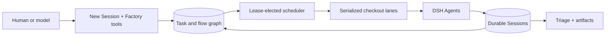

#🏭dsh-factory

**持久任务图和重复代理适用于 [DeepSeek Harness](https://github.com/deepseek-ai/deepseek-harness)**

_从一条提示到一条具有依赖性感知的生产线 — 具有独立的结帐、实时会话和可审查的结果。_

**dsh-factory** 将普通的 DSH 会话工作流程转变为持久的本地任务工厂。人们可以从新会话中捕获工作，模型可以直接构建依赖关系图，租赁选择的调度程序通过本机 DSH 代理运行符合条件的节点，而无需引入第二个代理循环、工具注册表或对话存储。

## 为什么是工厂？

| |能力|它解锁了什么 |
| :-: | --- | --- |
| 🕸️ | **依赖关系图** |一个命名流中的并行分支、顺序链、连接和始终运行的终结器。 |
| 🏃 | **本机代理运行** |每个任务都作为具有所选模型和预设的普通持久 DSH 会话执行。 |
| 🛤️ | **安全结帐通道** |托管 Git 工作树上的当前、隔离和前任重用通道，具有脏工作和实时会话保护。 |
| ⏰ | **一次性+循环计划** |延迟启动和 Croner 支持的复发，具有租赁安全激活和非重叠事件。 |
| 💬 | **一流的讨论** |在一个按时间顺序排列的提要中发布提示、引导消息、可重新排序的排队跟进、图像和工厂注释。 |
| 🔎 | **分类和工件** |未读和失败的运行结果、突变收据以及每次运行的 `.artifacts/` 目录下发现的图像和视频。 |
| ✨ | **白手套摄入** |紧凑的任务/流程选择器扩展了新会话，而不是复制其工作区、模型、权限、附件和草稿控件。 |

## 如何搭配



Factory 是 DSH 的控制平面，而不是其替代品。 Factory SQLite 拥有项目、任务、流程、计划、运行和审查状态。 DSH 在代理执行、模型可见消息、待处理提示订单、工具、附件、会话和工作树安全方面仍然具有权威。

## 工作流程

1. **捕获** — 正常发送以创建实时会话，为草稿任务选择 **稍后运行**，或将提示放入新的或现有的流程中。
2. **Compose** — 添加可搜索依赖项、并行分支、连接、终结器、标签、优先级、计划和模型覆盖。
3. **运行** - 调度程序声明准备工作，解析安全结账通道，启动 DSH 代理，并使用依赖项和突变分类帐上下文记录分配。
4. **协作** — 通过代理收件箱排队和引导帖子；待处理的行在声明之前保持可编辑和可重新排序。
5. **完成** — `factory_finish` 仅在代理空闲且刷新其会话日志后才稳定。
6. **审查** — 分类会保留每个终端事件，包括重复运行、收据、摘要、失败和 `.artifacts/` 媒体。

## 套餐

### 套餐·责任
- **包**：[`dsh-factory-protocol`](packages/protocol) · **职责**：独立于主机的任务、流程、运行、调度、观察和图形记录。
- **包**：[`dsh-factory-store`](packages/store) · **职责**：持久化服务定义。
- **包**：[`dsh-factory-store-sqlite`](packages/store-sqlite) · **责任**：交易文档、存在、修订和调度程序租赁。
- **包**：[`dsh-factory-domain`](packages/domain) · **职责**：状态转换、元数据结算、工件和 Typert Remote 方法。
- **软件包**：[`dsh-factory-tools`](packages/tools) · **职责**：模型图工具、显式完成和捆绑的 Factory 技能。
- **软件包**：[`dsh-factory-scheduler`](packages/scheduler) · **职责**：依赖项、通道、cron、清理和 DSH 代理协调。
- **套餐**：[`dsh-factory-client-ui`](packages/client-ui) · **职责**：工作、任务详细信息、分类、新会话摄入量和项目设置。
- **软件包**：[`dsh-factory`](.) · **责任**：可安装的 Cordis 补丁层捆绑包。

## 安装

### Monotykamary DSH 口味

Factory 在 Fabric 和 Fovea 旁边的自定义 Web 配置文件中提供：

```bash
npm install --global @monotykamary/dsh@latest
dsh --profile web
```

### 添加到另一个兼容的配置文件

```bash
dsh plugin --profile web add dsh-factory@latest
```

安装后重新启动选定的配置文件。 Factory 显示为附加侧边栏应用程序，并将其 SQLite 数据库存储在 DSH 主目录下。

在本地安装此结账

```bash
git clone https://github.com/monotykamary/dsh-factory.git
cd dsh-factory
pnpm install
pnpm run check
pnpm run install:local -- --profile web --skip-build
```

安装程序链接所有八个工作区包，验证组成的 Factory 行，并且从不启动或重新启动 DSH。

## 安全模型

结账是一个序列化的作家通道。工厂从不强制删除工作树，从不删除脏工作，并且在共享状态报告实时会话时从不释放通道。它拒绝主要的和非托管的结账删除。发布仍然是一项显式任务，清理无法重写流程结果。

重复任务在每次发生后都会返回到**计划**，并在分类中保留每次成功或失败。调度程序接管仅恢复调度程序拥有的调度，因此对外部会话的观察不能创建重复的运行。

## 浏览器体验

工作首先显示新兴工作，然后显示按图排序的流程。任务详细信息结合了属性、依赖性、时间表、模型选择、运行输出、讨论、突变收据和评论媒体。关系轨道从中性待定节点移动到蓝色运行旋转器、绿色完成检查或红色突然故障交叉。

粘贴的图像重复使用 DSH 附件库和全屏灯箱。任务详细信息和精确运行分类会在所属结帐的 `.artifacts/` 目录中发现图像和视频，并打开一个可通过键盘访问的轮播，而无需将媒体复制到工厂状态。

## 发展

要求：Node.js `^22.19.0 || >=24` 和 pnpm 11。

```bash
pnpm install
pnpm run check
```

面向浏览器的更改还针对组装的 Factory Web 配置文件运行 `pnpm run test:e2e`。本地捕获属于 `.artifacts/screenshots/`，不包括在 Git 和 npm 中。

请参阅 [`docs/architecture.md`](docs/architecture.md) 了解持久权限、摄入、元数据、调度、执行、分类、清理和浏览器状态所有权。