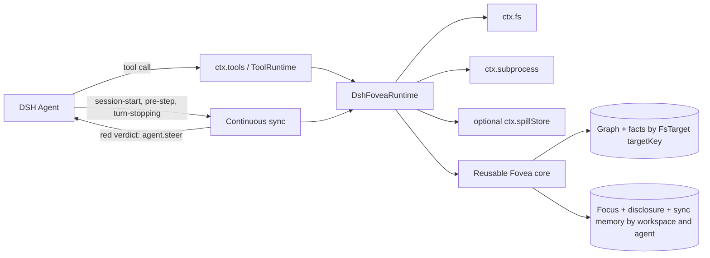

# 👁️ dsh-fovea

**Foveated repository intelligence for [DeepSeek Harness](https://github.com/deepseek-ai/deepseek-harness)**

_See the whole workspace, sharp where the agent works and cheap everywhere else._

  

**dsh-fovea** adapts [pi-fovea](https://github.com/monotykamary/pi-fovea) into a native DeepSeek Harness plugin and bundle. It compiles a repository into a typed, weighted graph, turns a question or change set into an interest field, diffuses relevance through that graph, and spends a bounded context budget where it matters.

The implementation composes with Harness rather than building a parallel host: DSH owns tools, policy, lifecycle, logs, filesystem access, subprocesses, and optional spills. Fovea adds four repository-intelligence tools, continuous structural drift detection, a slash command, and a runtime skill.

## What it provides

### Surface · Purpose
- **Surface**: `fovea_sketch` · **Purpose**: Survey feature basins, routes, hubs, and extraction coverage.
- **Surface**: `fovea_focus` · **Purpose**: Center on a symbol, route, concept, or file and reveal its semantic neighborhood.
- **Surface**: `fovea_dwell` · **Purpose**: Widen the current focus without repeating disclosed periphery.
- **Surface**: `fovea_impact` · **Purpose**: Rank the blast radius and review order of files, symbols, worktree changes, or a base-ref diff.
- **Surface**: `/fovea` · **Purpose**: Human-facing status, reset, sketch, focus, dwell, and impact commands when `ctx.commands` is present.
- **Surface**: `fovea` skill · **Purpose**: Model/user guidance registered when `ctx.skills` is present.
- **Surface**: Continuous sync · **Purpose**: Quiet baselining plus logged steering when repository drift is structurally surprising.

Every model tool returns one canonical JSON value:

```ts
{ text: string, tokens: number, details: Record<string, JSONValue> }
```

Harness renders `text` to the model while Code Mode and other programmatic callers retain `tokens` and `details`. Fovea does **not** replace native grep or exact file reads: use it to decide where and why, then inspect the selected source precisely.

## Requirements

- Node.js `^22.19.0 || >=24.0.0`
- pnpm `11.20.0` for this checkout
- DeepSeek Harness services pinned to `0.1.0-rc.6`
- Cordis `^4.0.1`
- Git for tracked-file discovery, base-ref impact, and co-change history (plain directories still work)

`@ast-grep/cli` is a runtime dependency. Executable resolution is: `FOVEA_AST_GREP`, then the packaged CLI, then a bare `ast-grep` on the active subprocess provider's `PATH`. A remote subprocess provider cannot execute the host package's binary, so install ast-grep in that execution world or set `FOVEA_AST_GREP` to its provider-visible path.

## Install from this checkout

The safe local installer builds this package, records any prior profile dependency, asks the pinned DSH CLI to add the checkout link, and verifies the composed `dsh-fovea` row. It never starts or restarts DSH.

```bash
# Defaults to the web profile
pnpm run install:local

# Select another profile
pnpm run install:local -- --profile tui

# Reuse already-built artifacts
pnpm run install:local -- --skip-build

# Use a non-default DSH home
DSH_HOME=/path/to/home pnpm run install:local
```

Reload or restart the selected running profile after installation. Verify composition directly with:

```bash
pnpm dlx @monotykamary/dsh@0.1.0-rc.7 --profile web --dump-config
```

Uninstall only the link owned by this checkout and restore the exact previous dependency, if any:

```bash
pnpm run uninstall:local
pnpm run uninstall:local -- --profile tui
```

After an npm release exists, the equivalent profile operation is expected to be:

```bash
pnpm dlx @monotykamary/dsh@0.1.0-rc.7 plugin --profile web add dsh-fovea
```

## Model tool reference

All roots come from the calling agent's session `cwd`; no Fovea tool accepts an arbitrary filesystem root. Tool `max_tokens` values are clamped to `256–16000`.

### `fovea_sketch(max_tokens?)`

Use once near the start of work in an unfamiliar repository. It emphasizes production anchors and structural hubs while collapsing tests and distant regions.

### `fovea_focus(query, max_tokens?, fresh?, path?, language?, kind?)`

`query` may be a symbol, route, concept, or repository-relative file. Optional filters narrow by path, language, or graph-node kind. Set `fresh` to reset disclosure even when the nucleus matches the previous focus.

Supported kinds are `function`, `method`, `class`, `interface`, `type`, `field`, `decl`, `file`, and `anchor`.

### `fovea_dwell(factor?, max_tokens?)`

Widen the current agent-scoped focus. The default diffusion multiplier is `2`; values below `1.2` are raised to `1.2`, and diffusion time is capped internally.

### `fovea_impact(files?, symbols?, include_uncommitted?, base?, max_tokens?)`

Seed a hypothetical or real change and rank consequences with causal paths. With no explicit seeds it includes uncommitted work; supplying `base` computes a `base...HEAD` comparison unless `include_uncommitted` is also requested.

A productive sequence is:

1. `fovea_sketch` for an unfamiliar repository.
2. `fovea_focus` on the most concrete task noun.
3. Native reads/grep on the suggested windows.
4. `fovea_dwell` only if the first neighborhood is too narrow.
5. `fovea_impact` before finishing a cross-file change.

## Human command

When the profile provides `ctx.commands`, dsh-fovea registers:

```text
/fovea status
/fovea reset
/fovea sketch
/fovea focus <query>
/fovea dwell [factor]
/fovea impact [files...]
```

`/fovea <query>` is also a focus shortcut. Command output uses the configured default budget.

## Configuration

The bundle patch inserts one row with id `dsh-fovea`. Override it in the selected profile's `$DSH_HOME/profiles//cordis.patch.yml` (or a later `--patch` layer):

```yaml
- id: dsh-fovea
  config:
    defaultBudget: 768
    toolTimeoutMs: 120000
    sync:
      mode: enabled
      scope: session
      budget: 512
      steerThreshold: 0.15
      pushFocus: true
      ackClean: false
      warmMutations: true
```

### Key · Default · Valid values
- **Key**: `defaultBudget` · **Default**: `512` · **Valid values**: integer `256–16000`
- **Key**: `toolTimeoutMs` · **Default**: `120000` · **Valid values**: integer `1000–2147483647`
- **Key**: `sync.mode` · **Default**: `enabled` · **Valid values**: `enabled`, `hidden`, or `disabled`
- **Key**: `sync.scope` · **Default**: `session` · **Valid values**: `session` steers only for top-level directories/root files this conversation entered while indexing the whole root; `repository` restores root-wide steering
- **Key**: `sync.budget` · **Default**: `512` · **Valid values**: integer `128–8192`
- **Key**: `sync.steerThreshold` · **Default**: `0.15` · **Valid values**: finite number `0.02–8`
- **Key**: `sync.pushFocus` · **Default**: `true` · **Valid values**: boolean
- **Key**: `sync.ackClean` · **Default**: `false` · **Valid values**: boolean — tiny "nothing new" ack after a clean structural check
- **Key**: `sync.warmMutations` · **Default**: `true` · **Valid values**: boolean

Unknown configuration keys fail plugin loading. `enabled` emits plugin `notice` messages; `hidden` uses plugin `instructions` messages for the model; `disabled` removes sync and mutation-attribution hooks while keeping explicit tools, command, and skill. The deployment-level `FOVEA_TURN_SYNC=off` (also `0` or `false`) escape hatch always forces disabled mode.

### Advanced environment controls

These are deployment-level tuning controls read when modules load:

### Variable · Default · Range / meaning
- **Variable**: `FOVEA_AST_GREP` · **Default**: packaged CLI · **Range / meaning**: Execution-world ast-grep path/name override
- **Variable**: `FOVEA_TURN_SYNC` · **Default**: unset · **Range / meaning**: `off`, `0`, or `false` disables continuous sync
- **Variable**: `FOVEA_MAX_FILES` · **Default**: `8000` · **Range / meaning**: `100–100000` discovered files
- **Variable**: `FOVEA_MAX_FILE_BYTES` · **Default**: `1048576` · **Range / meaning**: `65536–67108864` bytes per source
- **Variable**: `FOVEA_MAX_ROOTS` · **Default**: `2` · **Range / meaning**: `1–32` resident workspace graphs
- **Variable**: `FOVEA_MAX_AGENT_SESSIONS` · **Default**: `32` · **Range / meaning**: `1–4096` resident agent/session attention states
- **Variable**: `FOVEA_SPAWN_CONCURRENCY` · **Default**: `3` · **Range / meaning**: `1–32` concurrent subprocess stages
- **Variable**: `FOVEA_IO_CONCURRENCY` · **Default**: `32` · **Range / meaning**: `4–512` concurrent provider I/O operations
- **Variable**: `FOVEA_MAX_SUBMODULE_DEPTH` · **Default**: `4` · **Range / meaning**: `1–16` nested repository depth
- **Variable**: `FOVEA_AST_GREP_CHUNK` · **Default**: `160` · **Range / meaning**: `32–2048` files per parser chunk
- **Variable**: `FOVEA_PROBE_TTL_MS` · **Default**: `1200` · **Range / meaning**: `200–60000` send-path Git probe interval
- **Variable**: `FOVEA_MEMORY_HALF_LIFE_HOURS` · **Default**: `48` · **Range / meaning**: `1–8760` surprise-memory half-life
- **Variable**: `FOVEA_COCHANGE_HALF_LIFE_DAYS` · **Default**: `30` · **Range / meaning**: `1–3650` co-change half-life
- **Variable**: `FOVEA_WALK_GAP_MS` · **Default**: `4000` · **Range / meaning**: `500–300000` plain-root relist gap
- **Variable**: `FOVEA_SWEEP_GAP_MS` · **Default**: `20000` · **Range / meaning**: `2000–600000` plain-root full sweep gap

Invalid integer environment values fall back to the listed default.

## Continuous sync

The lifecycle integration is active unless `sync.mode` is `disabled`:

1. `agent/session-start` begins indexing asynchronously and establishes a quiet content-hash baseline; a first `agent/pre-step` observes the cold build in flight and proceeds without waiting for the repository walk.
2. Any tool result carrying versioned Harness file-mutation receipts contributes its exact SHA-1 transitions, including third-party and nested mutators. Receipt batches preserve their durable commit order, require one bounded journal update, and perform no extra file reads.
3. `tools/result` debounces and coalesces mutation paths into background graph refresh and impact preparation.
4. `agent/pre-step` performs a deferred drift check and appends model context only when a prepared red verdict exists.
5. `agent/turn-stopping` schedules the full correctness check and returns immediately, so repository indexing never delays `turn/end` or the idle status transition. A later red verdict calls `agent.steer(...)`; cancellation or Agent disposal aborts undelivered work.
6. With `sync.ackClean: true`, a clean structural check outside silent-baseline paths emits one tiny "nothing new" ack — appended like a deferred update so it can never restart an idle agent.
7. Branch checkout generations re-baseline quietly; charged cascades cool over time instead of echoing every turn.

With the default `sync.scope: session`, path-bearing read/search/edit tools, explicit focus/dwell results, and file-seeded impact calls add the top-level logical directory (or exact root file) of every path they touch to that conversation's attention. Fovea still indexes and baselines the whole root; drift solely in sibling directories is absorbed silently into the next baseline instead of becoming model context, so broad umbrella coverage does not become broad model context. Set `sync.scope` to `repository` to restore root-wide steering. A meaningful current, mixed, or unattributed change inside the attention scope still steers after the turn-stop check completes; a change attributed solely to another agent session is queued for the next user prompt instead and never restarts an idle agent.

Shell side effects, external editors, and mutation paths without receipts remain `unattributed`. Provenance distinguishes current-session, other-session, mixed, and unattributed transitions when exact hash chains permit it. Current DSH provenance is process-memory scoped, bounded to 2,048 records, and pruned after seven days.

All injected context uses DSH message sources under plugin `dsh-fovea`, so Harness owns transcript durability and presentation.

The math behind the graph, heat kernel, literal bridges, co-change seeding, inferred basins, discovery mode, and the turn-sync surprise gate is documented in [docs/heat-diffusion.md](docs/heat-diffusion.md).

## Architecture and adaptation boundary



### Layer from pi-fovea · dsh-fovea strategy
- **Layer from pi-fovea**: Graph types, joins, basins, extraction facts, heat diffusion, ranking, rendering · **dsh-fovea strategy**: Reused with minimal algorithmic change.
- **Layer from pi-fovea**: Filesystem discovery, ast-grep, Git, caches, provenance, overflow · **dsh-fovea strategy**: Retained behind the `FoveaRuntime` capability seam and DSH providers.
- **Layer from pi-fovea**: Focus, dwell, disclosure, sync baselines, surprise memory · **dsh-fovea strategy**: Agent/workspace-scoped rather than root-global.
- **Layer from pi-fovea**: Pi entry point, event names, TUI widgets/settings, hidden-message API, grep takeover · **dsh-fovea strategy**: Not reused; replaced by Cordis plugin loading, canonical DSH tools, agent events, command, skill, and system-prompt guidance.

There is intentionally no browser client plugin: dsh-fovea contributes server/runtime behavior and appears through existing Harness tool, command, skill, and transcript surfaces.

### Execution-world rules

- Repository paths resolve from the calling agent's session `cwd` through `ctx.fs`.
- Provider `FsTarget.targetKey` identifies shared graph/fact state; `ctx.fs.processPath(...)` crosses only into the matching subprocess provider.
- Git and ast-grep run through `ctx.subprocess`, with bounded output, timeout, cancellation, and process-tree ownership.
- Optional isolation: `runtime.createWorktree(id, cwd, name, preserveSourceSubdirectory?)` adds a git worktree outside the repository on a `dsh-fovea/<label>-` branch and returns a lease (`gitRoot`, `path`, `cwd`, `branch`); `runtime.removeWorktree(id, deleteBranch?)` tears it down. The manager reaches git only through the same `ctx.subprocess` path, so leases behave identically for standalone Node and DSH provider runtimes.
- DSH cache/provenance entries are bounded in-memory data: 32 MiB per entry and 128 MiB total. They do not survive a DSH process restart.
- The standalone Node adapter uses private temporary-disk cache files instead.
- Complete overflow lists use optional `ctx.spillStore` only for top-level tool calls that carry session/call ownership. Command and sync rendering stays bounded without creating unowned spills.

## Indexing, coverage, and limits

Fovea keeps the graph complete only within its configured indexing envelope; every rendered answer remains token-bounded.

- Default discovery stops at 8,000 supported files.
- Sources over 1 MiB, generated/minified bundles, unreadable files, and parser-failed chunks are omitted or degraded and reported in `details` and `/fovea status`.
- Ignored directories include `.git`, `node_modules`, `dist`, `vendor`, virtual environments, build outputs, coverage, `target`, and common dependency caches.
- Nested repositories/submodules are progressively enrolled when observed work touches them instead of being traversed eagerly.
- Plain non-Git roots use provider directory walks. Git roots additionally gain tracked/untracked discovery, base diffs, and recency-decayed co-change history.
- Repository-owned `.fovea/rules.json` is loaded automatically and extends built-in anchor/file-route rules. Treat repository rule files as trusted project configuration.

The implemented language tiers are:

- Full symbol/call extraction: TypeScript, TSX, JavaScript, Python, Go, and Rust.
- Outline-symbol extraction: Elixir, Ruby, C, C++, Java, Kotlin, Lua, PHP, Swift, Scala, Haskell, and Bash.
- Literal/config joins: YAML, JSON, TOML, env, Terraform/HCL, Markdown, and route conventions including OpenAPI-style paths.

Framework and language coverage is tiered; an empty result is not proof of absence when extraction reports degraded coverage.

### Repository rule example

```json
{
  "rules": [
    {
      "id": "custom-http-route",
      "langs": ["TypeScript"],
      "pattern": "$R.endpoint($P, $$$H)",
      "methods": "^endpoint$",
      "kind": "route"
    }
  ],
  "fileRoutes": [
    {
      "id": "custom-file-route",
      "re": "(?:^|/)endpoints/(.+)\\.ts$",
      "verbs": "suffix",
      "kind": "route"
    }
  ]
}
```

Malformed or invalid entries are ignored and built-in rules remain active.

## Programmatic core API

The `dsh-fovea/core` export supports local Node consumers through the same runtime seam:

```ts
import {
  NodeFoveaRuntime,
  sketch,
  withFoveaRuntime,
} from 'dsh-fovea/core'

const runtime = new NodeFoveaRuntime(process.cwd(), { scopeKey: 'example' })
const result = await withFoveaRuntime(runtime, () =>
  sketch(runtime.processRoot, 512),
)
console.log(result.text)
```

Implementations embedding the engine can provide their own `FoveaRuntime`; operations must always execute inside `withFoveaRuntime(...)`.

### Worktree isolation

The same seam exposes pi-fabric-style worktree isolation for embedding agent execution:

```ts
import { NodeFoveaRuntime } fro