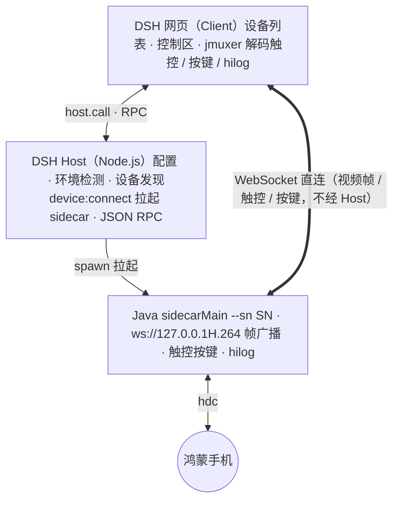

# dsh-hos-scrcpy — DSH 鸿蒙投屏控制插件

开发手机软件的时候总是手机电脑来回操作，所以搞了个这玩意，在 Deepseek Harness 网页里就能控制。

在 DSH 网页内直接投屏并操作鸿蒙（HarmonyOS NEXT）手机：实时画面、鼠标触控、系统按键、hilog 日志，无需在两个屏幕之间切换。

## 功能

- **设备发现**：USB / 局域网无线调试（hdc 已连接设备自动列出）
- **实时投屏**：H.264 视频流，网页播放（jmuxer.js）
- **触控操作**：鼠标点击 / 拖动 = 手机触摸（坐标自动换算设备分辨率）
- **系统按键**：返回 / 主页 / 音量+ / 音量- 按钮
- **hilog 日志**：设备实时日志滚动查看（每秒限速 60 行，保留最近 500 行）
- **自适应布局**：右侧控制区宽度按手机屏幕比例自动调整，聊天区自动让位
- **环境自动检测**：`JAVA_HOME` / `DEVECO_SDK_HOME` 环境变量优先，支持手动配置

## 环境要求

### 依赖 · 说明
- **依赖**: DSH 运行环境 · **说明**: 动态版以动态 Cordis 插件形式加载；静态版以 npm 包（tgz）常驻
- **依赖**: Java 8+ · **说明**: sidecar 桥接程序运行环境
- **依赖**: hdc · **说明**: DevEco Studio 自带（`<DevEco>/sdk/default/openharmony/toolchains/hdc.exe`）
- **依赖**: 鸿蒙手机 · **说明**: 开启开发者模式 + USB 调试（或 `hdc tconn` 无线连接）

## 参考项目

本项目基于 [HOScrcpy](https://gitcode.com/OpenHarmonyToolkitsPlaza/HOScrcpy)开发。
原项目采用 [MIT 开源协议](https://gitcode.com/OpenHarmonyToolkitsPlaza/HOScrcpy/blob/main/LICENSE)。

## 使用

### 1. 动态版（会话内加载，重启失效）

在 DSH 会话中定义并运行插件：`code.host` 填入 `PluginMain-Dynamic/host.js` 全文，`code.client` 填入 `PluginMain-Dynamic/client.js` 全文，`cordis_run` 激活，批准后右上角出现「设备列表」按钮：

1. 设备列表 → 鸿蒙设备 → 点「投屏」
2. 等待部署（首次约 10 秒，需推送手机端组件）
3. 右侧出现控制区：手机画面 + 按键
4. 点「日志▸」查看 hilog 实时日志

### 2. 静态版（npm 包常驻，推荐）

```bash
# 1. 安装 tgz 到 web profile（转发 pnpm）
dsh plugin --profile web add dsh-hos-scrcpy-1.0.0.tgz

# 2. 编辑 $DSH_HOME/profiles/web/package.json，把包加入 bundle 列表：
#    "dsh": { "profile": { "bundles": ["@deepseek-ai/dsh-base", "@deepseek-ai/dsh-web-app", "dsh-hos-scrcpy"] } }
```

重启 `dsh web` 后插件常驻，不再随 DSH 进程重启失效。可先用 `dsh --profile web --dump-config` 确认组合树中出现 `hos-scrcpy` 行。改动代码后重新打包：

```bash
cd PluginMain-Static && npm pack
```

## 架构



## 安全说明

- sidecar 只监听 `127.0.0.1` 回环地址（随机端口），不暴露局域网
- 无任何外部网络请求（审计确认：全部源码与原生库无外联域名）
- 设备端命令仅限白名单（hilog / uinput / uitest / snapshot_display 等）
- 仅支持本机 hdc 已连接设备（USB / 局域网无线调试），不含远程真机模式

## 已知限制

- 键盘文本输入未内置（系统输入法注入延迟高，已移除），输入请在手机上操作或使用系统输入法配合鼠标点击
- 仅支持鸿蒙设备；安卓暂不支持
- 动态版定义随 DSH 进程重启失效，需重新定义加载；静态版不受此限制

## 构建 sidecar（如需重新编译）

```bash
# 源码：Dev/src/Main.java；SDK jar：hosScrcpy-1.0.18-beta.jar
# 动态版产物（覆盖 PluginMain-Dynamic/out）：
javac -encoding UTF-8 -cp "" -d PluginMain-Dynamic/out Dev/src/Main.java
# 静态版产物（覆盖 PluginMain-Static/resources/out，随后重新 npm pack）：
javac -encoding UTF-8 -cp "" -d PluginMain-Static/resources/out Dev/src/Main.java
```

## 集成到其他软件开发

启动如下命令：
```bash
# 启动 sidecar（自动发现唯一在线设备）
java -cp "<SDK jar>;<out目录>" Main --hdc "<hdc路径>" --port 18999
```
并打开 Dev/demo/index.html 参考开发