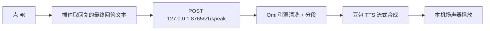

# dsh-omi-voice

  

沉浸式听朗读 · 豆包音质
点一下 🔊，把 AI 回复用豆包的自然音色念给你听——无需复制，不做自动朗读
DeepSeek Harness 插件 · BYOK · MIT

[](https://awesome-dsh-plugin.com)

让 DeepSeek Harness（DSH）桌面端里的 AI 回复，用**豆包自然音色**读给你听。语音由你本机常驻的 Omi 引擎合成，**豆包 API Key 只留在你自己的钥匙串里（BYOK）**。

  
  

## 快速概览

### 项目 · 说明
- **项目**: 插件名称 · **说明**: `dsh-omi-voice`
- **项目**: 适配平台 · **说明**: DeepSeek Harness（`dsh web`，含桌面端）+ macOS 上的 Omi 引擎 v0.1.2+
- **项目**: 解决的问题 · **说明**: DSH 内置朗读（系统语音 / Edge TTS）音色机械、像上个时代的播报腔；通用剪贴板工具又要先复制再读
- **项目**: 工作方式 · **说明**: 点回复旁 🔊 朗读/暂停/继续；只读最终回答，工具日志/代码/表格/图形朗读前自动过滤
- **项目**: 语音能力 · **说明**: 豆包 TTS 1.0（`seed-tts-1.0`），自然中文音色，支持暂停/继续（从暂停处续播）
- **项目**: 隐私特性 · **说明**: API Key 存入 Omi 引擎的 macOS Keychain；插件零 Key；仅本机 `127.0.0.1` 通信
- **项目**: 成本 · **说明**: BYOK，按字符计费；内存 LRU 缓存 + 去重，避免重复请求
- **项目**: 开源协议 · **说明**: [MIT License](LICENSE)

## 三步开始朗读

1. 安装插件 + 构建并打开 Omi 引擎（见下方「获取豆包 API Key」与「安装」）。
2. 在 Omi 引擎设置页保存一次豆包 API Key。
3. 在 DSH 对话里点 AI 回复旁的 🔊，即可朗读。



## 获取豆包 API Key（新手必读）

本插件是 **BYOK（自带 Key）**：豆包语音由你自己的火山引擎账户按字符计费。三步拿到 Key：

**第 1 步 · 找到「豆包语音」**：登录[火山引擎控制台](https://console.volcengine.com/)，进入「豆包语音」（语音技术）服务。


**第 2 步 · 开通「语音合成 1.0」**：在产品列表里开通「语音合成大模型 / 语音合成 1.0」。


**第 3 步 · 创建 API Key**：创建 Access Key 时，**关联第 2 步开通的「语音合成 1.0」服务**；把得到的 API Key 填进 Omi 引擎「设置 > API Key」并保存。


> API Key 只保存进 Omi 引擎的 macOS Keychain，插件侧零 Key、不出本机。

## 安装

```bash
dsh plugin --profile web add "github:PolinniZhong/dsh-omi-voice#v0.1.2&path:/"
```

本地开发可直接装目录：

```bash
dsh plugin --profile web add /path/to/dsh-omi-voice
```

引擎（Omi DSH）构建见 [engine/README.md](engine/README.md)：`./engine/build/build-service.sh` 后 `ditto` 到 `~/Applications/Omi DSH.app`。

## 使用

  

- **🔊 点读**；播放中再点 = **暂停**，再点 = **从暂停处继续**；点其它消息的 🔊 = 打断并读新的。
- **只读最终回答**：工具执行日志、思考过程不会读；代码围栏、表格、纯图形（盒绘/ASCII）在请求前过滤，回复若只有这些内容，按钮呈禁用态并提示"没有可朗读的内容"。
- 引擎未启动 / 未配置 Key 时，点击会给出明确提示（含去哪打开 Omi）。

## 成本透明

豆包 TTS（`seed-tts-1.0`）按**字符数**计费，由你在火山引擎账户自行承担。为此：

- 只有**手动点 🔊** 才合成，不自动朗读；
- 引擎对相同文本 3 秒内去重，且进程内 LRU 缓存最近 3 条（≤5MB、纯内存、退出即清），重复朗读不重复计费；
- 纯表格/纯代码等无有效内容不发请求（`invalid_text`）。

## 架构与协议

插件只是"遥控器"：播放、变速、暂停/继续、缓存、文本清洗全部在 Omi 引擎内完成。协议见 [docs/API.md](docs/API.md)（`/v1/status`、`/v1/speak`、`/v1/pause`、`/v1/resume`、`/v1/stop`）。

## FAQ

### 问题 · 回答
- **问题**: 点 🔊 提示"未检测到 Omi DSH 引擎" · **回答**: 打开应用「Omi DSH」（`~/Applications` 或 ⌘空格 搜 "Omi"），建议开「开机启动」
- **问题**: 提示"请先在 Omi 设置页配置豆包 API Key" · **回答**: 打开「Omi DSH」设置，按上文「获取豆包 API Key」填一次并保存
- **问题**: 按钮是灰的 / 点它没反应 · **回答**: 这条回复没有可朗读的内容（纯代码/表格/图形），已自动过滤
- **问题**: 音色能换吗 · **回答**: 在 Omi 设置页「音色 ID」改（当前插件不提供音色 UI）
- **问题**: 支持 Windows 吗 · **回答**: 暂不支持：Omi 引擎仅 macOS Apple Silicon
- **问题**: 和 dsh-voice-chat 的区别 · **回答**: 它零 Key 零成本但用系统机械音色；本插件用豆包自然音色，代价是 BYOK 按字符计费

## 相关

- 引擎：[本仓库 `engine/`](engine/README.md)（Omi DSH 本地引擎，Swift 源码 + 构建脚本）
- 生态：[awesome-dsh-plugin](https://github.com/beancookie/awesome-dsh-plugin)

## 项目文档

- [AGENTS.md](AGENTS.md) — 给 AI 编码代理的项目说明（Codex 约定）
- [docs/DESIGN.md](docs/DESIGN.md) — 架构与设计
- [docs/DECISIONS.md](docs/DECISIONS.md) — 设计决策记录
- [docs/MEMORY.md](docs/MEMORY.md) — 长期知识库（坑/结论）
- [docs/HANDOFF.md](docs/HANDOFF.md) — 交接与续作
- [docs/API.md](docs/API.md) — 本地协议