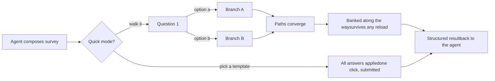

# dsh-rich-questions

**Branching surveys for [DeepSeek Harness](https://github.com/deepseek-ai/deepseek-harness) — authored live by your agent, answered in your chat.**

Your agent doesn't just *send* a questionnaire — it *composes* one from the conversation's context: a directed graph of questions where each answer decides what gets asked next, every option carries its own reasoning, and the whole thing renders in the same composer seat you're already looking at. One tool call. No forms product, no account, no copy-paste.

> 富问题/问卷系统 — 由 agent 现场编写的分支问卷：每个答案决定下一题，每个选项自带洞察与流程图，直接在聊天输入框位置作答。

MIT · zero runtime dependencies · DSH ≥ 0.1.1-rc.1 · Node ≥ 20



## Install

```sh
dsh plugin --profile web add dsh-rich-questions
```

Restart the `dsh web` process, refresh the tab — done. The `ask_survey` tool is now visible to every agent preset. (From a fork: `dsh plugin --profile web add file:/path/to/dsh-rich-questions`.)

## What you get

### ·
- **分支路径** · 每个选项都声明其后面的内容 (`next`)。选择 *C*，获得与 *A* 不同范围的问题。多选扇出深度优先；跳过/自由文本完全通过；主机独立地重新导出路径，因此声明的路径始终是可验证的。
- **每个选项的情报** · 见解（约 6 行：什么是伟大的/权衡/“（今天）”）、来源和引文，以及紧凑的 **美人鱼图** - 所有这些都在点击展开的披露（文本为 `?`，图表的分支图标）；永远不会有悬停伏击。
- **对齐** · 所选选项获得铅笔可供性：在一行中说明*为什么*您选择此选项（内联输入、复选标记或 Enter 提交，在提交前随时可重新编辑）。原因是答案为 `justifications`——代理在获取后续信息时会读取您陈述的意图。
- **快速模式** · 开始旁边最多有六个整体调查决策模板 (`a`–`f`) —“像 Vercel/Railway 一样发货：首先完善 + DX”与“精益内部工具：快速发货”。单击即可应用完整、连贯的答案图并提交。 20 个问题的协调练习变成了一个单一的决定。
- **存储并继续** · 长期调查的每一步承诺：到目前为止的答案在您立即前进时*在后台*转到主机。银行答案**锁定**（之后永远只能查看），重新加载后仍然存在，并跟随您到任何浏览器。 `{n} banked` 芯片跟踪它们。
- **持久的进步** · 每次调查都会自动保存草稿 - 重新加载、切换选项卡、明天再回来：同样的问题、同样的答案、同样的立场。没什么可按的。
- **飞行前指导** · **重新滚动**（重写得更干净），**推动**（深入研究：12+竞争对手，GitHub开源存储库，`.refs/`策划的参考文献 - 基于具体证据的选项，而不是猜测），**讨论**（放下表格，讨论它） - 在第一个问题之前，每次单击一次。
- **语言跟随你** · 英语聊天→英语调查。 中文→中文。任何语言→那种语言，始终如一。
- **主机权威** · 待处理的调查位于主机上 - 关闭浏览器，终止选项卡，工具继续等待，向导在重新连接时重新水化。

## 为什么它存在

`ask_user_question` 非常适合 1-3 个简单问题，仅此而已。真正的工作——期望收集、验收标准、跨十几个交互维度确定构建范围——需要**路径**（一个答案会改变接下来重要的事情）、**深度**（单行标签不足以选择好）和**速度**（有时你已经知道目的地）。 `ask_survey` 就是这个系统，它保持简单的流程不变。

## 比较如何

针对主要调查平台和向导提交模式进行了研究：

### 能力 · dsh-rich-questions · Typeform · SurveyMonkey · Google Forms · MS Forms
- **能力**：根据对话上下文实时撰写调查 · **dsh-rich-questions**： ✅ · **Typeform**： — · **SurveyMonkey**： — · **Google Forms**： — · **MS Forms**： —
- **功能**：图形分支（每个选项 `next`） · **dsh-rich-questions**： ✅ 原生 · **Typeform**：逻辑跳转（付费） · **SurveyMonkey**：✅ · **Google Forms**：仅限部分 · **MS Forms**：基本
- **功能**：重新加载恢复进度 · **dsh-rich-questions**： ✅ 自动保存 · **Typeform**：同一浏览器 · **SurveyMonkey**：通过简历链接 · **Google Forms**：同一浏览器 + 登录 · **MS Forms**： ❌
- **功能**：承诺的答案在浏览器丢失后仍可保存 · **dsh-rich-questions**：✅ 银行、任何浏览器 · **Typeform**：部分（付费） · **SurveyMonkey**：❌ · **Google Forms**：❌ · **MS Forms**：❌
- **功能**：答案一旦提交即锁定 · **dsh-rich-questions**：✅ · **Typeform**：❌ · **SurveyMonkey**：❌ · **Google Forms**：❌ · **MS Forms**：❌
- **功能**：一键式整体调查决策模板 · **dsh-rich-questions**：✅ · **Typeform**：❌ · **SurveyMonkey**：❌ · **Google Forms**：❌ · **MS Forms**：❌
- **能力**：重写/深入研究/讨论重定向 · **dsh-rich-questions**：✅ · **Typeform**：❌ · **SurveyMonkey**：❌ · **Google Forms**：❌ · **MS Forms**：❌
- **功能**：每个选项的见解 + 来源 + 图表 · **dsh-rich-questions**： ✅ · **Typeform**：描述 · **SurveyMonkey**：描述 · **Google Forms**：描述 · **MS Forms**：描述
- **功能**：许可证 · **dsh-rich-questions**：麻省理工学院 · **Typeform**：商业 · **SurveyMonkey**：商业 · **Google Forms**：免费（帐户） · **MS Forms**：免费（帐户）

*还研究了：Qualtrics、Jotform、Tally、Fillout、SurveySparrow 部分提交行为和 Stripe/TurboTax 风格的每步向导提交 - 银行业务遵循向导模式，但没有任何调查工具实现。*

## 向导

在作曲家座位上渲染，实时分支路径上每页一个问题：

- 进度条+针对*当前*路径的已回答/总计； back 根据保存的答案重新评估分支
- 带复选框的多选、自由文本 `other` 行、每个问题 `skippable`
- **出血行语法**：选项行从卡片的边缘到边缘运行，由 1 像素细线分隔线分割（无浮动芯片）；自由文本行有自己的分隔线，页脚是一个出血工具栏 - 操作按钮向右浮动，作为由垂直细线分隔的全高段，后退箭头和进度保持在左侧
- 每个操作按钮均由延迟工具提示解释 - 开始/下一步/提交（上下文）、跳过、银行、快速、重新滚动、推送、讨论、后退、最小化、取消
- 键盘可操作的行，带有咏叹调标记的控件； UI chrome 本地化（EN / 简体中文，在其他地方优雅地回退）
- 主机权威挂起状态、环回防护路由、SSE + 轮询补充

## 创作指南

一种规格，每种功能：

```json
{
  "survey": {
    "title": "Expectation alignment",
    "intro": "Short markdown preamble — the first page.",
    "entry": "q1",
    "questions": {
      "q1": {
        "prompt": "Which direction fits this release?",
        "header": "Scope",
        "detail": "Optional markdown context.",
        "options": [
          {
            "key": "a",
            "label": "Ship the public surface",
            "description": "One-line tradeoff, always visible.",
            "insight": "**What great looks like** — …\n**Tradeoff** — …\n**(today)** — …",
            "diagram": "flowchart TD; ship-->polish; polish-->latency; latency-->done",
            "sources": ["https://example.com/rfc-1"],
            "recommended": true,
            "next": "q2a"
          },
          { "key": "b", "label": "Rework the core first", "next": "q2b" },
          { "key": "other", "label": "Something else" }
        ],
        "next": "q2b"
      },
      "q2a": { "prompt": "…", "next": "q3" },
      "q2b": { "prompt": "…", "next": "q3" },
      "q3":  { "prompt": "…", "multiSelect": true }
    },
    "quick": [
      { "key": "a", "label": "Highest standard: Vercel/Railway grade", "recommended": true,
        "insight": "Who this is for, what it optimizes, the tradeoff.",
        "answers": { "q1": { "selected": ["a"] }, "q2a": { "selected": ["b"] }, "q3": { "selected": ["a", "c"] } } },
      { "key": "b", "label": "Lean internal tool", "answers": { "q1": { "selected": ["b"] } } }
    ]
  }
}
```

**边缘语义** — 严格执行：

### 情况 · 关注
- **情况**：单选，选项有 `next` · **跟随**：该选项的 `next`（id、列表或 `null` = 结束）
- **情况**：单选，选项无`next` · **遵循**：题级`next`
- **情况**：多选 · **跟随**：每个选定选项的分支，深度优先，按选项顺序
- **情况**：跳过/仅限自由文本 · **遵循**：问题文件