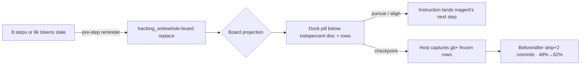

# dsh-rich-tracking

**Percent-progress scoreboard for [DeepSeek Harness](https://github.com/deepseek-ai/deepseek-harness)** — a docked board below the todo pill showing rows with live percents derived from artifact truth, checkpoints with host-captured git state, and operator whip-actions that land in the agent's next step as attributed instructions.

> 进度记分板：停在 todo 胶囊下方的百分比看板——每行百分比来自工件事实，检查点由宿主抓取 git 真实状态，pursue/align/dismiss 直接鞭策到 agent 的下一步。



## Install

```sh
dsh plugin --profile web add dsh-rich-tracking
```

Restart the `dsh web` process — `tracking_write` and `tracking_checkpoint` become available to every agent preset, and the board renders in the conversation dock (order 5: below the todo pill, above the goal bar).

## The grammar

**todos are the micro plan (this turn); tracking is the mission scoreboard (across turns).** The board deliberately does not reset on `turn/start` — waves, milestones, and multi-session objectives survive until every row is 100 or you dismiss it.

### Rows and percent honesty

Each row is `{id, label, percent, status?, note?, evidence?, items?}`:

- `percent` = **(acceptance items that hold right now) / (total)** in the row's owning artifacts — plan checkboxes, landed receipts, verified readbacks. Never an impression.
- Every row with `percent >= 1` **must** carry `evidence` naming that basis (paths + checked/total). Validation rejects a percent without evidence — the schema enforces what the operator calls "not vibes".
- `percent: 100` requires every item checked AND the owning receipt to exist. A 100% row dims but stays visible until the whole board is done.
- `items` (optional, 1-20): the row's acceptance checklist `[{ label, done }]` — click the row on the board to expand it in place. Done items grey out with strikethrough; open items stay readable in the primary color. When items are present, `percent` MUST equal `round(done/total × 100)`; validation rejects a mismatch, so the visible checklist always adds up to the shown percent.
- Overall completion is item-weighted: every item is one unit; a row without items contributes one unit at `percent/100`. With no items anywhere this is exactly the rounded mean of row percents — legacy boards keep their math.
- Rows: 1-12 (aim 3-7), stable ascii ids (`w2-fleet`) so checkpoints and actions can reference them.

### Checkpoints — receipts, not narration

`tracking_checkpoint` 使 **主机** 捕获 git 分支/HEAD/脏状态加上冻结的板。该模型从不输入 git 事实。该板显示之前/之后的条带：`+2 commits · overall 48% → 62% · W2 fleet 30% → 55%`。

### 操作员动作（鞭子）

每行和全板：**追踪**（使该行成为下一个焦点），**委托**（将该行交给后台子代理），**对齐**（从工件中重新导出每个百分比 - 测谎仪通过），**检查点**，**解雇**。根据代理下一步中的归属指令追踪/委托/对齐土地（运行时转向，空闲时跟进）；解雇是一个安静的音符——任何后来具有真实状态的 `tracking_write` 都会复活被解雇的董事会，因为真相胜过最终结果。

**委托**向代理发送独立的委托简介：行的标签、百分比、带有已完成标志、证据和注释的项目清单，以及要求 - 具有读/写访问权限的后台子代理，其范围严格限于该行的任务和子任务，子代理保留其**自己的** `tracking_write` 板（范围为该任务，每步更新的百分比），以及折叠回父级的可验证收据（提交、测试结果、文件路径）报告到达时行。

### 游戏模式 — 自动从事最高价值的工作

药丸头上有一个 ▶/⏸ 按钮。当**播放**打开时（绿色，脉冲），每个 `turn/end` 都会触发自动参与：董事会根据价值比率对待处理行进行排名（首先是活跃行 - 动量很重要 - 然后按百分比降序：最高百分比 = 最接近完成 = 最容易实现的目标），命名获胜者，并发送后续通知，告诉代理立即处理它。每个回合后都会重复循环，直到暂停、棋盘被消除或每行达到 100。消除自动暂停。

### /track — 强制账本同步

`/track`（可选 `/track <message>`）是 `/plan` 系列中的主机命令：它将**完整账本加上跟踪原则**作为用户可见的消息注入到代理的下一步中 - 每行包含百分比、状态、项目标志、证据和注释，然后是重新推导指令（读取命名工件 - 文档、代码、收据、用户上下文 - 重新计算百分比为已检查/总计，修复陈旧的项目/散文，写出更正的板）。由于还没有板，它会注入创建指令。尾随消息就像操作员自己的话一样。虽然存在实时板，但每个用户提交的内容也会在回合的第一步携带单行板提醒（每当更丰富的跟踪上下文（`/track` 同步、鞭子指令或陈旧提醒）已在组件中时，就会进行重复数据删除）。

### 生活账本节奏

该公告教导了步骤绑定的职责：在**每个**完成的任务/步骤/待办事项之后，其工件真相发生了变化——刷新百分比和项目标志——并且每当底层细节发生变化时，行散文（标签、注释、证据、项目）就会更新。董事会总是描述当前的现实，而不是里程碑的快照。

### 刷新循环

当代理工作时，董事会就会变得陈旧。在没有 `tracking_write` 的情况下**8 个辅助步骤或 6k 个输出令牌**之后，下一个模型请求将带有一个标记的提醒，命名过时的行。每回合一个；当董事会解散或完成时，没有任何规定。

## 比较如何

### 能力 · todo_write · 目标栏 · 丰富的问题 · **丰富的跟踪**
- **功能**：终身 · **todo_write**：每回合 · **目标栏**：任务（服务） · **丰富问题**：每次工具调用 · **丰富跟踪****：**任务（会话事件）**
- **能力**：进度信号· **todo_write**：状态计数· **目标栏**：阶段标签· **丰富的问题**：已回答/总计· **丰富的跟踪****：**每行％+总体，证据绑定**
- **功能**：操作员操作 · **todo_write**：无 · **目标栏**：暂停/恢复/编辑 · **丰富的问题**：回答/重新滚动/推送 · **丰富的跟踪****：**追踪/委托/对齐/检查点/播放/暂停 + /track**
- **功能**：代理鞭子 · **todo_write**：描述 · **目标栏**：总结上下文 · **丰富的问题**：飞行前说明 · **丰富的跟踪****：**步骤前刷新 + 操作说明**
- **功能**：证据绑定 · **todo_write**：无 · **目标栏**：目标文本 · **丰富的问题**：来源/见解 · **丰富的跟踪****：**每行证据 + git 捕获的检查点**
- **功能**：哪里 · **todo_write**：停靠点 0 · **目标栏**：停靠点 10 · **丰富的问题**：作曲家席位 · ****丰富的跟踪****：**停靠点 5**

## 棋盘的 UI 语法

该药丸克隆了内置 TodoPanel 的精确语法：**36px 折叠高度**、本机状态字形（活动的渐变旋转环、完成的圆形检查、挂起的虚线环），以及 - 自 v0.1.1 以来 - **出血行**：行列表沿卡片边缘到边缘运行，行之间有 1px 细线分隔线（无浮动圆形芯片），悬停和选择色调跨越整个宽度，以及标题操作集群（对齐·检查点·取消·V 形）位于药丸右边缘的分段，全高单元被垂直细线分开。单击即可展开项目清单的行；项目清单在完成后会变灰并带有删除线。 UI 本地化为英语和简体中文。

＃＃ 建筑学

````
src/host.js 节点一半——tracking_write+tracking_checkpoint工具，
                       “跟踪”会话投影（无轮重置），代理/预步骤
                       刷新提醒+每回合棋盘提醒，/track命令，
                       Loopback-fenced /api/rich-tracking/action 路线（追求/
                       委托/对齐/解散/检查点）。仅限节点内置函数。
src/tracking-engine.js 纯引擎——板验证（自我修复消息、项目
                       数学）、投影折叠、线视图、百分比数学、分类帐
                       渲染。仅限主机。 16节点：测试用例：npm测试。
src/client.bundle.js 浏览器一半 — 扩展坞板：百分比盘丸、出血行
                       带有悬停显示的操作和项目清单，分段
                       标题操作、条带之前/之后的检查点、工具提示。
                       仅 React + 客户端原语。
cordis.patch.yml 插入 p 的捆绑补丁