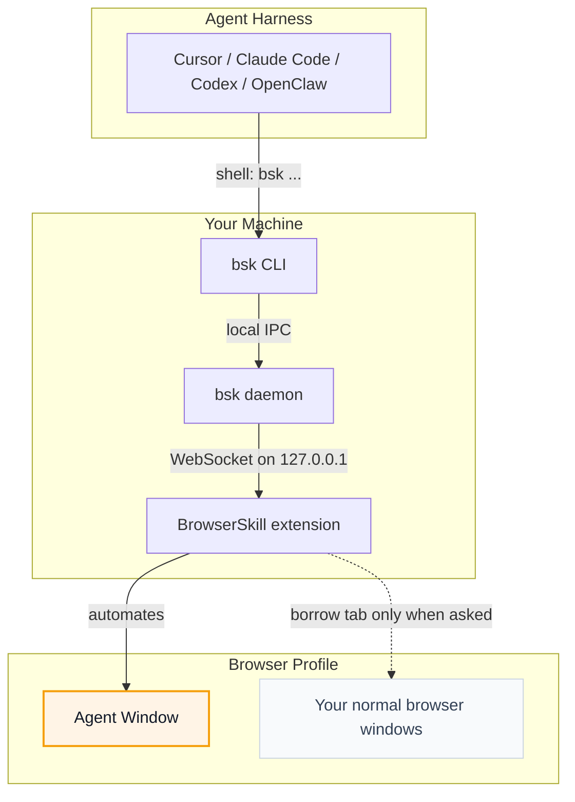

# BrowserSkill

  

  Let AI agents use your browser without interrupting your work.

**BrowserSkill** connects Cursor, Claude Code, Codex, OpenClaw, CodeBuddy,
WorkBuddy, Pi, Hermes Agent, DeepSeek Harness, and other AI agents to your already logged-in
browser.

Need the agent to touch a tab you already have open? It must borrow that tab
explicitly, return it when the task is done, and leave the rest of your browser
alone.

https://github.com/user-attachments/assets/db782c92-b1d4-4aae-a255-039675937a90

## BrowserSkill Advantages

- **Reuse real login state**: Agents can work with sites you are already signed
  into, without separate test accounts.
- **Keep working uninterrupted**: browser tasks run in a separate, visible
  Agent Window, so you can keep using your own browser.
- **Support any Agent**: any Agent that can call a shell can use BrowserSkill
  through the `bsk` CLI, with no lock-in to a specific model, Agent framework, or
  harness.
- **Built-in human-in-loop**: when a task hits captcha, login, confirmation
  dialogs, or other human-only steps, the Agent can ask you to take over and
  then continue afterwards.

## Runtime Environment

BrowserSkill has two local runtime pieces: the `bsk` CLI/daemon and the browser
extension.

### Runtime · Support
- **Runtime**: Operating systems · **Support**: macOS (Apple Silicon and Intel), Linux (x64 and ARM64), Windows x64
- **Runtime**: Browsers · **Support**: Chrome and Microsoft Edge are supported; other Chromium-based browsers are expected to work when they support unpacked Chromium extensions; Firefox is planned

## Quick Start

Install with your Agent (recommended)

Already using Cursor, Claude Code, Codex, or another shell-capable agent? Just
copy this one line and send it to your agent — it will install the CLI and skill
for you, then walk you through loading the extension:

```text
Set up browser-skill on this machine by following https://raw.githubusercontent.com/Tencent/BrowserSkill/main/AGENT_INSTALL.md
```

Manual install

Install the CLI, then install the extension from the [Chrome Web Store](https://chromewebstore.google.com/detail/hhcmgoofomhgciiibhipgmgkgnoenaoi)
or [Edge Add-ons](https://microsoftedge.microsoft.com/addons/detail/browserskill/emacgiaaaiojkkpkddmmdfhmokgmnikg).

#### 1. Install the `bsk` CLI

**macOS / Linux** (recommended — installs to `~/.local/bin`):

```bash
curl -fsSL https://raw.githubusercontent.com/Tencent/BrowserSkill/main/install.sh | sh
```

**Windows** (PowerShell — installs to `~/.local/bin`):

```powershell
irm https://raw.githubusercontent.com/Tencent/BrowserSkill/main/install.ps1 | iex
```

Verify the binary:

```bash
bsk --version
```

#### 2. Install the browser extension

Install BrowserSkill from your browser's store:

### Browser · Store listing
- **Browser**: Chrome · **Store listing**: [Chrome Web Store](https://chromewebstore.google.com/detail/hhcmgoofomhgciiibhipgmgkgnoenaoi)
- **Browser**: Microsoft Edge · **Store listing**: [Edge Add-ons](https://microsoftedge.microsoft.com/addons/detail/browserskill/emacgiaaaiojkkpkddmmdfhmokgmnikg)

On other Chromium-based browsers, install the Chrome Web Store build.

#### 3. Install the skill

BrowserSkill ships a skill that teaches your agent harness how to use `bsk`. For
these harnesses, install it in one step:


    [](https://cursor.com)<sub>Cursor</sub>
    [](https://docs.anthropic.com/en/docs/claude-code)<sub>Claude Code</sub>
    [](https://developers.openai.com/codex)<sub>Codex</sub>
    [](https://openclaw.ai)<sub>OpenClaw</sub>
    [](https://www.codebuddy.ai)<sub>CodeBuddy</sub>
    [](https://www.workbuddy.ai)<sub>WorkBuddy</sub>
    [](https://github.com/badlogic/pi-mono)<sub>Pi</sub>
    [](https://github.com/NousResearch/hermes-agent)<sub>Hermes Agent</sub>


```bash
bsk install-skill
```

Use <kbd>Space</kbd> to select the Agent harness you want to install into, then
press <kbd>Enter</kbd> to install the skill. Run `bsk install-skill --list` to see
internal variants and install paths.

Other shell-capable agent harnesses are supported too. Copy
[`skill/SKILL.md`](skill/SKILL.md) into your harness's skills directory as
`browser-skill/SKILL.md` to install the skill manually. DeepSeek Harness uses a
dedicated plugin instead — see [DeepSeek Harness plugin](#deepseek-harness-plugin).

Start a new Agent session and write a prompt that needs the browser, for example:

```text
/browser-skill open example.com and summarize what is on the page.
```

## DeepSeek Harness plugin

Using [DeepSeek Harness](https://github.com/deepseek-ai/deepseek-harness) (`dsh`)?
BrowserSkill ships a first-class dsh plugin on npm as
[`@wxg-prc-cpg/browser-skill-dsh-plugin`](https://www.npmjs.com/package/@wxg-prc-cpg/browser-skill-dsh-plugin).
It injects native `browser_*` tools (no shelling out to `bsk`) and a live Web UI
overlay of each Agent Window.

Add it to a dsh profile, then start that profile:

```sh
dsh plugin --profile web add @wxg-prc-cpg/browser-skill-dsh-plugin
dsh --profile web
```

The plugin carries its own copy of the skill, so `bsk install-skill` is not needed
for dsh — but the `bsk` CLI and the browser extension are still prerequisites. See
the [plugin README](packages/dsh-plugin-browserskill/README.md) for the tool list,
configuration, and the observation overlay.

## How It Works

BrowserSkill is a local bridge between your agent harness and your browser.



The agent never talks to the browser directly. It asks the `bsk` CLI to perform a
browser task; the local daemon routes that request to the extension; the
extension runs it in an Agent Window. DeepSeek Harness takes the same path
through the [plugin](#deepseek-harness-plugin): the agent calls injected
`browser_*` tools, and the plugin invokes `bsk` on its behalf.

## For Developers

The repository is a Cargo + pnpm workspace:

- `crates/bsk-cli` — `bsk` CLI and local daemon
- `crates/bsk-protocol` — shared wire types and JSON schemas
- `apps/extension` — browser extension
- `packages/ui` and `packages/i18n` — shared extension UI support
- `packages/dsh-plugin-browserskill` — DeepSeek Harness plugin (`@wxg-prc-cpg/browser-skill-dsh-plugin`)